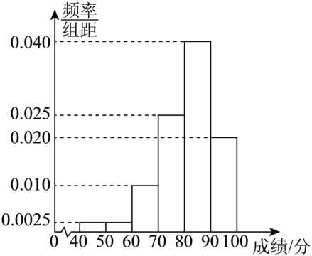

# Mathematics - 题目 1142

**ID**: 7bb628ebd70347f3a4a82721a9b6a8c2
**年级**: Grade 12
**难度**: Medium
**题型**: Multiple-select

## 题目
《国家学生体质健康标准》测试的主要目的是贯彻落实“健康第一”的指导思想，切实加强学校体育工作，促进学生积极参加体育锻炼，养成良好的锻炼习惯，从而增强体质、提高健康水平，把学生培养成为德、智、体、美、劳全面发展的高素质人才．某校对高一年级学生体育测试成绩抽样分析后，得到频率分布直方图如图，每组数据含左端点值，不含右端点值，则下列说法正确的是（      ）（同一组中的数据用该组区间的中点值为代表）​​​​​​​‌

## 解答

1. 对于A，高一年级学生体育测试的成绩在区间 $\left [{80,90}\right )$ 内最多，所以众数约为这个区间的中点85，故A正确；
2. 对于B，高一年级学生体育测试成绩在区间 $\left [{40,60}\right )$ 的频率为 $\left ({0.0025+0.0025}\right )\times 10=0.05$ ，所以高一年级学生体育测试成绩低于60分的学生约占 $5{\rm{\%}}$ ，故B错误；
3. 对于C，高一年级学生体育测试成绩的平均数约为 $45\times 0.025+55\times 0.025+65\times 0.1+75\times 0.25+85\times 0.4+95\times 0.2=80.75$ ，故C正确；
4. 对于D，高一年级学生体育测试成绩低于80分的学生约占 $\left ({0.0025+0.0025+0.010+0.025}\right )\times 10=40{\rm{\%}}$ ，故第60百分位数大于80，故D错误．
5. 故选：AC．

## 知识点

**中文**:
  - 众数
  - 频率分布直方图
  - 平均数
  - 百分位数

**English**:
  - Mode
  - Frequency Distribution Histogram
  - Mean
  - Percentile

---
