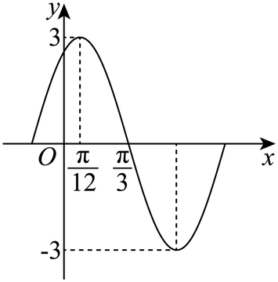

# Mathematics - 题目 1232

**ID**: 7ecebccc95a446cab3403662dea75be8
**年级**: Grade 12
**难度**: Medium
**题型**: Multiple-select

## 题目
函数 $f\left ({x}\right )=A{\rm{s}}{\rm{i}}{\rm{n}}\left ({ωx+φ}\right )\left ({A>0,ω>0,\left |{φ}\right |<\frac {{\rm{π}}}{2}}\right )$ 的部分图象如图所示，则下列说法正确的是（      ）​​​​​​​‌

## 解答

1. 由图可知 $f\left ({x}\right )$ 的最大值为3，所以 $A=3$ .
2. 因为 $f\left ({\frac {{\rm{π}}}{12}}\right )=3$ ， $f\left ({\frac {{\rm{π}}}{3}}\right )=0$ ， $\left |{φ}\right |<\frac {{\rm{π}}}{2}$ ，所以 $\begin{cases}\begin{matrix}\frac {ω{\rm{π}}}{12}+φ=\frac {{\rm{π}}}{2}，\\\frac {ω{\rm{π}}}{3}+φ={\rm{π}}，\end{matrix}\end{cases}$ 解得 $\begin{cases}\begin{matrix}ω=2，\\φ=\frac {{\rm{π}}}{3}，\end{matrix}\end{cases}$ 所以 $f\left ({x}\right )={{3}}{\rm{s}}{\rm{i}}{\rm{n}}\left ({{{2}}x+\frac {{\rm{π}}}{{{3}}}}\right )$ .
3. A选项， $f\left ({x}\right )$ 的最小正周期为 $\frac {2{\rm{π}}}{ω}={\rm{π}}{\rm ，A}$ 正确；
4. B选项，令 $t=2x+\frac {{\rm{π}}}{3}$ ，则当 $x\in \left [-\frac {{\rm{π}}}{2},-\frac {{\rm{π}}}{4}\right ]$ 时， $t\in \left [-\frac {{{2}}{\rm{π}}}{3},-\frac {{\rm{π}}}{6}\right ]$ ，从而 $f\left ({x}\right )$ 在 $\left [-\frac {{\rm{π}}}{2},-\frac {{\rm{π}}}{4}\right ]$ 上先减后增，B错误；
5. C选项，因为 $2\times \left ({-\frac {11{\rm{π}}}{12}}\right )+\frac {{\rm{π}}}{3}=-\frac {{{3}}{\rm{π}}}{2}$ ，所以直线 $x=-\frac {11{\rm{π}}}{12}$ 为 $f\left ({x}\right )$ 的一条对称轴，C正确；
6. D选项，若 $f\left ({x+θ}\right )={{3}}{\rm{s}}{\rm{i}}{\rm{n}}\left ({{{2}}x+2θ+\frac {{\rm{π}}}{{{3}}}}\right )$ 为偶函数，则 $2θ+\frac {{\rm{π}}}{{{3}}}=\frac {{\rm{π}}}{2}+k{\rm{π}},k\in {\mathbf{Z}}$ ，解得 $θ=\frac {k{\rm{π}}}{2}+\frac {{\rm{π}}}{12},k\in {\mathbf{Z}}{\rm ，D}$ 正确.
7. 故选ACD.

## 知识点

**中文**:
  - 函数y=Asin（ωx＋φ）

**English**:
  - Function y=Asin(ωx+φ)

---
