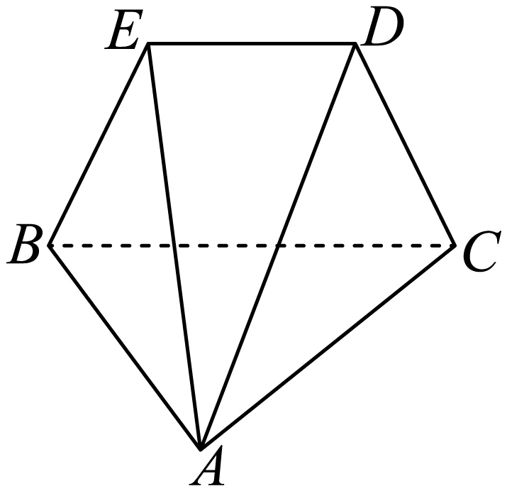

# Mathematics - 题目 2897

**ID**: 9fe0e7a140a14690bb86f84cb7ecd8ce
**年级**: Grade 12
**难度**: Medium
**题型**: Multiple-select

## 题目
如图，在五面体ABCDE中， $\vartriangle ABC$ 是边长为4的等边三角形，四边形BCDE是等腰梯形， $BE=CD=DE=2$ ，则（      ）​​​​​​​‌

## 解答

1. 由题设，平面 $BCDE$ 沿 $BC$ 翻转与平面 $ABC$ 形成一定夹角构成五面体ABCDE，
2. 由题意 $DE//BC$ ，又 $DE\not\subset $ 平面 ${\rm \mathit{ABC}，}BC\subset $ 平面ABC，所以 $DE//$ 平面ABC，A正确；
3. 延长CD，BE交于点F，若 $CD\bot $ 平面 ${\rm \mathit{ABE}，}BE\subset $ 平面ABE，则 $CD\bot BE$ ，
4. 由平面几何知识易知 $\angle DFE=60{}\degree $ ，故CD不垂直于平面ABE，B错误；
5. 取DE的中点G，BC的中点H，连接AG、GH、AH，则 $\angle AGH$ 为平面ADE与平面BCD所成角的平面角，
6. 由题意，点G可看作在平面AGH内以H为圆心，GH为半径的圆上的一点，
7. 由于 $GH=\sqrt {3}<AH=2\sqrt {3}$ ，必存在直线AG与该圆相切，存在 $AG\bot GH$ ，
8. 显然 $\vartriangle ADE$ 为等腰三角形，则 $AG\bot DE$ ， $DE\cap GH=G$ 都在平面 $BCDE$ 内，
9. 所以 $AG\bot $ 平面 $BCDE$ ， $AG\subset $ 平面 $ADE$ ，则平面 $ADE\bot $ 平面BCD，故存在这样的五面体ABCDE，C正确；
10. 取AF的中点I，连接BI、CI，则 $\angle BIC$ 为平面ABE与平面ACD所成角的平面角，
11. 当 $BI=2\sqrt {2}$ ，即 $AF=4\sqrt {2}$ 时， $\angle BIC=90{}\degree $ ，即 $BI\bot IC$ ，又 $BI\bot AF$ ，
12. $IC\cap AF=I$ 都在平面 $ACD$ 内，则 $BI\bot $ 平面 $ACD$ ， $BI\subset $ 平面 $ABE$ ，
13. 所以平面 $ABE\bot $ 平面ACD，此时 $AF<AH+HF$ ，故存在这样的五面体ABCDE，D正确．
14. 故选ACD.
15. 

## 知识点

**中文**:
  - 平面与平面垂直的判定
  - 直线与平面平行的判定
  - 直线与平面垂直的判定

**English**:
  - Plane-Plane Perpendicularity Determination
  - Line-Plane Parallelism Determination
  - Line-Plane Perpendicularity Determination

---
