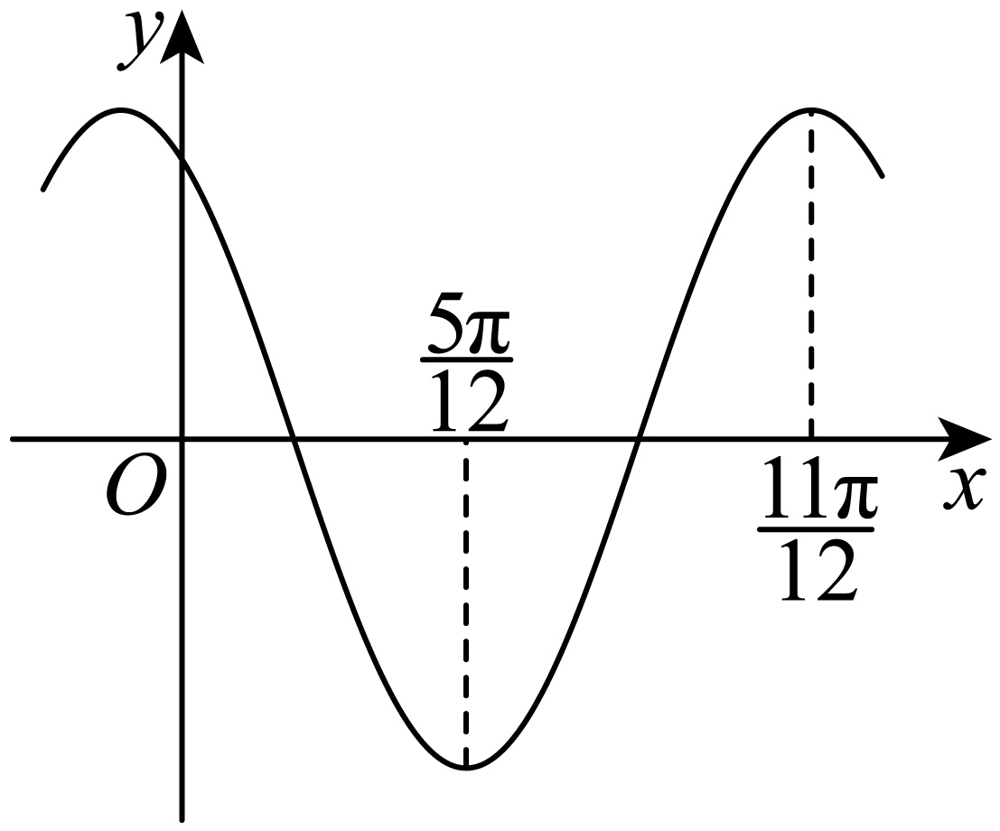

# Mathematics - 题目 3221

**ID**: de426e9bc8ff46d188c3761b2b9be169
**年级**: Grade 12
**难度**: Medium
**题型**: Multiple-select

## 题目
已知函数 $f\left ({x}\right )=\sin \left ({ωx+φ}\right )\left ({ω>0,\left |{φ}\right |<{\rm{π}}}\right )$ 的部分图象如图所示，则（      ）​​​​​​​‌

## 解答

1. 由图象可知，相邻最小值点 $x=\frac {5{\rm{π}}}{12}$ 和最大值点 $x=\frac {11{\rm{π}}}{12}$ 之间的水平距离为半个周期，
2. 即 $\frac {T}{2}=\frac {11{\rm{π}}}{12}-\frac {5{\rm{π}}}{12}=\frac {{\rm{π}}}{2}\Rightarrow T={\rm{π}}$ ，
3. 由周期公式 $T=\frac {2{\rm{π}}}{ω}={\rm{π}}\Rightarrow ω=2$ ，
4. 所以 $f\left ({x}\right )=\sin \left ({2x+φ}\right )$ ，选项A正确；
5. 因为图象经过点 $\left ({\frac {5{\rm{π}}}{12},-1}\right )$ ，代入函数得： $\sin \left ({2\cdot \frac {5{\rm{π}}}{12}+φ}\right )=-1\Rightarrow \sin \left ({\frac {5{\rm{π}}}{6}+φ}\right )=-1$ ，
6. 由正弦函数性质可知 $\sin θ=-1$ 时， $θ=\frac {3{\rm{π}}}{2}+2k{\rm{π}},k\in {\mathbf{Z}}$ ，
7. 所以 $\frac {5{\rm{π}}}{6}+φ=\frac {3{\rm{π}}}{2}+2k{\rm{π}}\Rightarrow φ=\frac {{{2}}{\rm{π}}}{3}+2k{\rm{π}}{\rm{,}}k\in {\mathbf{Z}}$ ，
8. 因为 $\left |{φ}\right |<{\rm{π}}$ ，所以 $φ=\frac {{{2}}{\rm{π}}}{3}$ ，  $f\left ({x}\right )=\sin \left ({2x+\frac {2{\rm{π}}}{3}}\right )$ ，
9. 因为 $φ=\frac {{{2}}{\rm{π}}}{3}\ne \frac {{\rm{π}}}{3}$ ，故B错误；
10. 因为 $y=\sin θ$ 是中心对称函数，对称中心为 $\left ({k{\rm{π}}{\rm{,}}{{0}}}\right )$ ， $k\in {\mathbf{Z}}$ ，
11. 若函数 $f\left ({x}\right )$ 图象关于点 $\left ({-\frac {4{\rm{π}}}{3},0}\right )$ 对称，则 $f\left ({-\frac {4{\rm{π}}}{3}}\right )=0$ .
12. 代入计算： $f\left ({-\frac {4{\rm{π}}}{3}}\right )=\sin \left ({2\cdot \left ({-\frac {4{\rm{π}}}{3}}\right )+\frac {{{2}}{\rm{π}}}{3}}\right )=\sin \left ({-2{\rm{π}}}\right )=0$ ，
13. 所以图象关于点 $\left ({-\frac {4{\rm{π}}}{3},0}\right )$ 对称，故C正确；
14. 将 $f\left ({x}\right )$ 图象上所有点的横坐标伸长为原来的2倍（纵坐标不变），则 $g\left ({x}\right )=\sin \left ({x+\frac {2{\rm{π}}}{3}}\right )$ ，
15. 由正弦函数性质可知 $y=\sin θ$ 在 $-\frac {{\rm{π}}}{2}+2k{\rm{π}}\leqslant θ\leqslant \frac {{\rm{π}}}{2}+2k{\rm{π}},k\in {\mathbf{Z}}$ 上单调递增，
16. 令 $-\frac {{\rm{π}}}{2}+2k{\rm{π}}\leqslant x+\frac {2{\rm{π}}}{3}\leqslant \frac {{\rm{π}}}{2}+2k{\rm{π}},k\in {\mathbf{Z}}$ ，解得 $-\frac {{{7}}{\rm{π}}}{6}+2k{\rm{π}}\leqslant x\leqslant -\frac {{\rm{π}}}{6}+2k{\rm{π}}{\rm{,}}k\in {\mathbf{Z}}$ ，
17. 区间 $\left [{\rm{π}},\frac {7{\rm{π}}}{4}\right ]$ 位于增区间 $\left [\frac {5{\rm{π}}}{6},\frac {{{1}}{{1}}{\rm{π}}}{6}\right ]$ 内，故 $g\left ({x}\right )$ 在区间 $\left [{\rm{π}},\frac {7{\rm{π}}}{4}\right ]$ 内是增函数，故D正确.
18. 故选ACD.

## 知识点

**中文**:
  - 三角函数的图象变换
  - 函数y=Asin（ωx＋φ）的图象和性质

**English**:
  - Transformation of Trigonometric Graphs
  - Graph and Properties of y=Asin(ωx+φ)

---
