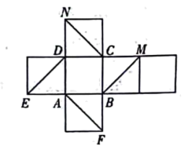

# Mathematics - 题目 1204

**ID**: f3f13a96fb2c444ead4920e6656d7a5c
**年级**: Grade 12
**难度**: Medium
**题型**: Multiple-select

## 题目
如图是一个正方体的平面展开图，则在该正方体中（      ）​​​​​​​‌

## 解答

1. 展开图翻折成的正方体如图所示，因为 $CN{\rm{/}}{\rm{/}}BE$ ， $BE\bot AF$ ，因此 $CN\bot AF$ ，所以A错误；同理 $DE{\rm{/}}{\rm{/}}CF$ ， $CF\bot BM$ ，所以 $BM\bot DE$ ，B正确； $\angle MBE$ 或其补角是 $CN$ 与 $BM$ 所成的角，又因为△ $MBE$ 是等边三角形，所以 $\angle MBE$  $=60{}^\circ $ ，所以 $CN$ 与 $BM$ 所成的角是 $60{}^\circ $ ，C正确；又 $NE//$ 平面 $MFBC$ ，且 $NE$ 与 $BM$ 不平行，故 $NE$ 与 $BM$ 是异面直线，D正确；
2. 故选BCD.
3. 

## 知识点

**中文**:
  - 异面直线所成角
  - 直线与直线的位置关系的判断

**English**:
  - Angle between Skew Lines
  - Determining Line-Line Relationships

---
