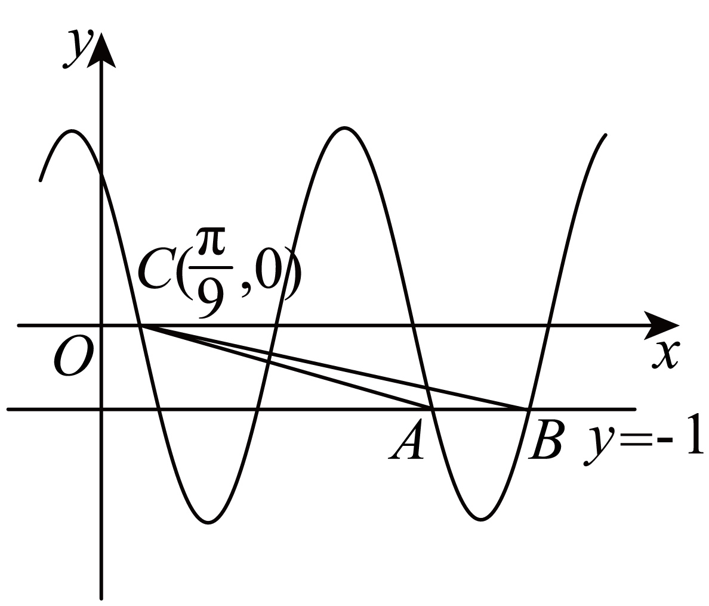

# Mathematics - 题目 1853

**ID**: fa96897b27ad47aea22c53f9a722fb3c
**年级**: Grade 12
**难度**: Medium
**题型**: Multiple-select

## 题目
如图，函数 $f\left ({x}\right )=2{\cos}\left ({ωx+φ}\right )\left ({ω>0,\left |{φ}\right |<\frac {{\rm{π}}}{2}}\right )$ 的部分图象与直线 $y=-1$ 交于 $A,B$ 两点，点 $C\left ({\frac {{\rm{π}}}{9},0}\right )$ 在曲线 $f(x)$ 上，且 $\vartriangle ABC$ 的面积为 $\frac {{\rm{π}}}{9}$ ，则（      ）​​​​​​​‌

## 解答

1. 设 $A(x{{}_{1}},y{{}_{1}})$ ， $B(x{{}_{2}},y{{}_{2}})$ ，
2. 因为 $\vartriangle ABC$ 的面积为 $\frac {{\rm{π}}}{9}$ ，所以 $\frac {1}{2}\left |{AB}\right |\times 1=\frac {{\rm{π}}}{9}$ ，
3. 则 $\left |{AB}\right |=\frac {2{\rm{π}}}{9}$ ，则 $x{{}_{2}}-x{{}_{1}}=\frac {2{\rm{π}}}{9}$ ，
4. 由图象可知， $ωx{{}_{1}}+φ=2k{\rm{π}}+\frac {2{\rm{π}}}{3},k\in {\rm{Z}}$ ， $ωx{{}_{2}}+φ=2k{\rm{π}}+\frac {4{\rm{π}}}{3},k\in {\rm{Z}}$ ，
5. 两式相减得， $ω\left ({x{{}_{2}}-x{{}_{1}}}\right )=\frac {2{\rm{π}}}{3}$ ，所以 $\frac {2{\rm{π}}}{9}ω=\frac {2{\rm{π}}}{3}$ ，所以 $ω=3{\rm ，A}$ 错误；
6. 则 $f\left ({x}\right )=2{\cos}\left ({3x+φ}\right )$ ，将点 $C\left ({\frac {{\rm{π}}}{9},0}\right )$ 代入 $f(x)$ 得， $2{\cos}\left ({3\times \frac {{\rm{π}}}{9}+φ}\right )=0$ ，
7. 由五点作图法可知， $\frac {{\rm{π}}}{3}+φ=\frac {{\rm{π}}}{2}$ ，所以 $φ=\frac {{\rm{π}}}{6}$ ，
8. 所以 $f\left ({x}\right )=2{\cos}\left ({3x+\frac {{\rm{π}}}{6}}\right )$ ，
9. 故 $f\left ({x-\frac {{\rm{π}}}{18}}\right )=2{\cos}\left [3\left ({x-\frac {{\rm{π}}}{18}}\right )+\frac {{\rm{π}}}{6}\right ]=3{\cos}3x$ ，
10. 令 $g\left ({x}\right )=3{\cos}3x$ ，定义域为 ${\rm{R}}$ ，关于原点对称，
11. 又 $g\left ({-x}\right )=3{\cos}\left ({-3x}\right )=3{\cos}3x=g\left ({x}\right )$ ，所以 $g\left ({x}\right )$ 为偶函数，B正确；
12. 令 $2k{\rm{π}}\leqslant 3x+\frac {{\rm{π}}}{6}\leqslant 2k{\rm{π}}+{\rm{π}}{\rm{,}}k\in {\rm{Z}}$ ，解得 $\frac {2k{\rm{π}}}{3}-\frac {{\rm{π}}}{18}\leqslant x\leqslant \frac {2k{\rm{π}}}{3}+\frac {5{\rm{π}}}{18}$ ， $k\in {\rm{Z}}$ ，
13. 取 $k=1$ ，则 $f(x)$ 在 $\left [\frac {11{\rm{π}}}{18},\frac {17{\rm{π}}}{18}\right ]$ 上单调递减，
14. 所以 $f(x)$ 在 $\left [\frac {2{\rm{π}}}{3},\frac {5{\rm{π}}}{6}\right ]$ 上单调递减，C正确；
15. 令 $3x+\frac {{\rm{π}}}{6}=2k{\rm{π}}+{\rm{π}}$ ， $k\in {\rm{Z}}$ ，解得 $x=\frac {2k{\rm{π}}}{3}+\frac {{{5}}{\rm{π}}}{18}$ ， $k\in {\rm{Z}}$ ，
16. 令 $\frac {2k{\rm{π}}}{3}+\frac {{{5}}{\rm{π}}}{18}=-\frac {7{\rm{π}}}{18}$ ，解得 $k=-1\in {\rm{Z}}$ ，
17. 所以当 $x=-\frac {7{\rm{π}}}{18}$ 时， $f(x)$ 取得最小值，
18. 所以 $f\left ({x}\right )\geqslant f\left ({-\frac {7{\rm{π}}}{18}}\right ){\rm ，D}$ 正确；
19. 故选BCD.

## 知识点

**中文**:
  - 余弦函数的单调性
  - 余弦函数的图象及应用
  - 余弦函数的奇偶性

**English**:
  - Monotonicity of Cosine Function
  - Graph and Applications of Cosine Function
  - Parity of Cosine Function

---
