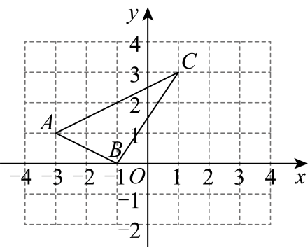

# Mathematics - 题目 2822

**ID**: 02cf1c42dd684178be6f017acf4ec9a6
**年级**: Grade 7
**难度**: Easy
**题型**: Calculation

## 题目
在如图所示坐标系中，三角形 $ABC$ 的三个顶点都在格点（正方形的顶点）上．（1）分别写出三角形 $ABC$ 三个顶点的坐标；​​​​​​​‌（2）将三角形 $ABC$ 沿着坐标轴方向平移，使点 $A$ 的对应点为 $A^{′}{\left ({-1,-1}\right )}$ ，点 $B$ 的对应点为 $B^{′}$ ，点 $C$ 的对应点为 $C^{′}$ ，请画出三角形 $A^{′}B^{′}C^{′}$ ；（3）已知三角形 $ABC$ 的边 $AB$ 上的点 $P$ ，经过（2）中的平移后到达点 $P^{′}$ 的位置，若线段 $AA^{′}$ 的长为 $a$ ，则线段 $PP^{′}$ 的长为．

## 解答

1. （1）解： $A\left ({-3,1}\right ),B\left ({-1,0}\right ),C\left ({1,3}\right )$ ；
2. （2）解： $A\left ({-3,1}\right )$ 平移到 $A^{′}{\left ({-1,-1}\right )}$ ，
3. 则 $-3+2=-1,1-2=-1$ ，
4. $\therefore $ 三角形 $ABC$ 先向右平移2个单位，再向下平移2个单位得到 $A^{′}B^{′}C^{′}$ ，
5. $\therefore $  $B^{′}{\left ({-1+2,0-2}\right )}$ 即 $B^{′}{\left ({1,-2}\right )}$ ， $C^{′}{\left ({1+2,3-2}\right )}$ 即 $C^{′}{\left ({3,1}\right )}$ ，
6. 如图所示， $\vartriangle A^{′}B^{′}C^{′}$ 为所求，
7. 
8. （3）解：由（2）知三角形 $ABC$ 先向右平移2个单位，再向下平移2个单位得到 $A^{′}B^{′}C^{′}$ ，
9. 则点P先向右平移2个单位，再向下平移2个单位得到 $P^{′}$ ，
10. $\therefore AA^{′}=PP^{′}=a$ ．

## 知识点

**中文**:
  - 作图——平移
  - 平移的性质

**English**:
  - Construction: Translation
  - Properties of Translation

---
