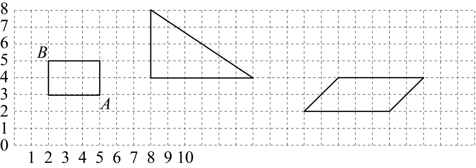

# Mathematics - 题目 218

**ID**: 0edfca9d71e84d1ab6eb3d3921595e48
**年级**: Grade 7
**难度**: Easy
**题型**: Calculation

## 题目
按要求作图．(1) $\mathrm{A}$ 的位置用数对表示是．(2)画出长方形绕 $\mathrm{A}$ 点顺时针旋转 $90{}\degree $ 后的图形．(3)按 $1:2$ 的比画出三角形缩小后的图形，缩小后三角形的面积是原来的．(4)用一条直线把平行四边形分成两部分，使它们的面积比是 $2:3$ ．​​​​​​​‌

## 解答

1. （1）点 $\mathrm{A}$ 的位置用数对表示是 $\left ({5,3}\right )$
2. （2）长方形绕 $\mathrm{A}$ 点顺时针旋转 $90{}\degree $ 后的图形，如图所示；
3. 
4. （3）按 $1:2$ 的比画出三角形缩小后的图形，如图所示，
5. $\because $ 原来三角形的面积 $=\frac {1}{2}\times 4\times 6=12$ ，缩小后三角形的面积 $=\frac {1}{2}\times 2\times 3=3$ ，
6. $\therefore $ 缩小后三角形的面积是原来的 $\frac {1}{4}$ ．
7. （4）∵三角形的面积 $=\frac {1}{2}\times 4\times 2=4$ ，梯形的面积 $=\frac {1}{2}\times \left ({1+5}\right )\times 2=6$ ，
8. $\therefore $ 三角形的面积与梯形面积的比是 $2:3$ ，
9. $\therefore $ 直线 $MN$ 把平行四边形分成两部分，使它们的面积比是 $2:3$ ．

## 知识点

**中文**:
  - 有序数对
  - 画旋转图形
  - 相似三角形的性质

**English**:
  - Ordered Pairs
  - Drawing Rotated Figures
  - Properties of Similar Triangles

---
