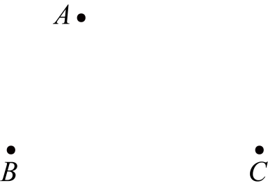

# Mathematics - 题目 996

**ID**: 312b4b64a1a745eba5319f6838d022c3
**年级**: Grade 7
**难度**: Easy
**题型**: Calculation

## 题目
如图，在同一平面内有三个点 $\mathrm{A}$ ， $B$ ， $C$ ．(1)利用尺规，按下面的要求作图．要求：不写作法，保留作图痕迹，不必写结论；​​​​​​​‌①作射线 $BA$ ；②作线段 $BC$ ；③连接 $AC$ ，并在线段 $AC$ 上作一条线段 $AD$ ，使 $AD=AB$ ，连接 $BD$ ．(2)观察（1）题得到的图形， $DB+DC$$BC$ （填“＞”“＜”或“＝”）

## 解答

1. （1）解：如图所示：①射线 $BA$ 即为所求作；②线段 $BC$ 即为所求作；③以A点为圆心， $AB$ 长为半径画弧，交 $AC$ 于点D，连接 $BD$ ．
2. 
3. （2）解：在 $\mathrm{△}DBC$ 中， $DB+DC>BC$ ．
4. 故答案为：>

## 知识点

**中文**:
  - 尺规作图——作线段
  - 直线、射线、线段的定义
  - 比较线段的长短

**English**:
  - Construction: Drawing a Line Segment
  - Definitions
  - Comparing Line Segments

---
