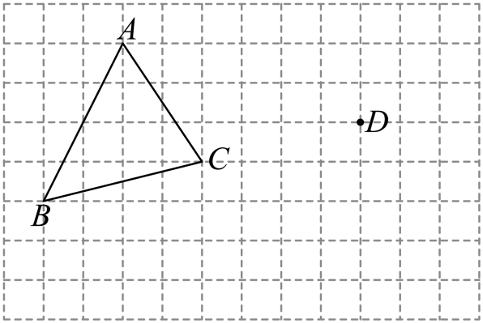

# Mathematics - 题目 2003

**ID**: 31f227c1d5e24824883c200abaa51492
**年级**: Grade 7
**难度**: Easy
**题型**: Calculation

## 题目
在正方形网格中，每个小正方形的边长均为1个单位长度， $\vartriangle ABC$ 的三个顶点A，B，C都在格点（正方形网格的交点称为格点）上．现将 $\vartriangle ABC$ 平移，使点A平移到点D，点E，F分别是B，C的对应点．(1)在图中请画出平移后的 $\vartriangle DEF$ ，并求出 $\vartriangle DEF$ 的面积是；​​​​​​​‌(2)在网格中标出所有满足条件的格点P（A点除外），使 $S{{}_{\vartriangle ABC}}=S{{}_{\vartriangle BCP}}$ ．

## 解答

1. （1）解：平移后的 $\vartriangle DEF$ 如图所示：
2. 
3. ∴ $S{{}_{\vartriangle DEF}}=4\times 4-\frac {1}{2}\times 4\times 1-\frac {1}{2}\times 2\times 3-\frac {1}{2}\times 2\times 4=7$ ；
4. （2）解：根据平行线间的距离相等可知：在格点图中画出与 $BC$ 平行的直线，如图所示直线与格点的交点 $P{{}_{{\rm{1}}}}$ ， $P{{}_{{\rm{2}}}}$ ， $P{{}_{{\rm{3}}}}$ ， $P{{}_{{\rm{4}}}}$ 即为所求．

## 知识点

**中文**:
  - 作图——平移
  - 平行线之间的距离
  - 平移的性质

**English**:
  - Construction: Translation
  - Distance Between Parallel Lines
  - Properties of Translation

---
