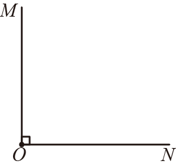

# Mathematics - 题目 1670

**ID**: 3e9cad7873cd4b87bc2b1aafff5905e5
**年级**: Grade 7
**难度**: Easy
**题型**: Calculation

## 题目
如图，已知 $OM\bot ON$ ，请利用量角器、直尺按照下列要求完成画图并解答问题．(1)在线段 $ON$ 的延长线上截取点A，使得 $OA=2OM$ ；​​​​​​​‌(2)连接线段 $MA$ ；(3)利用刻度尺找到线段 $MA$ 的中点P；(4)连接 $OP$ ；(5)直接写出 $OP$ 与 $MA$ 的数量关系_；(6)如果 $OA=a{\rm{，}}OM=b$ ， $\left ({a>0，b>0}\right ){\rm ，（5）}$ 中的关系是否还成立_．（填写是或否）

## 解答

1. （1）解：如图，延长 $ON$ 使得 $OA=2OM$ ，则点A即为所求；
2. （2）如图，线段 $MA$ 即为所求；
3. （3）如图，点P即为所求；
4. （4）如图，线段 $OP$ 即为所求；
5. 
6. （5） $\because OM\bot ON$ ，
7. $\therefore \angle MON=90{}\degree $ ，
8. ∵点P为线段 $MA$ 的中点，
9. $\therefore OP=\frac {1}{2}MA$ ，
10. 即 $MA=2OP$ ．
11. （6）由题意知，无论 $OA$ 、 $OM$ 多长，根据直角三角形斜边上的中线性质，都有 $MA=2OP$ ，
12. 即（5）中的关系还成立

## 知识点

**中文**:
  - 尺规作图——作线段
  - 直角三角形斜边上的中线
  - 线段的中点

**English**:
  - Construction: Drawing a Line Segment
  - Median to Hypotenuse of Right Triangle
  - Midpoint of a Line Segment

---
