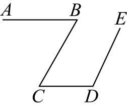

# Mathematics - 题目 3072

**ID**: 414c7e0432ea47268358b3b27d9d9cad
**年级**: Grade 7
**难度**: Easy
**题型**: Calculation

## 题目
已知：如图所示， $AB{\rm{/\mskip-4mu/}}CD$ ， $\angle B+\angle D=180{}\degree $求证： $BC/\mskip-4mu/DE$ ．​​​​​​​‌

## 解答

1. 证明：∵ $AB{\rm{/\mskip-4mu/}}CD$ ，
2. ∴ $\angle B=\angle C$ ，
3. ∵ $\angle B+\angle D=180{}\degree $
4. ∴ $\angle C+\angle D=180{}\degree $
5. ∴ $BC/\mskip-4mu/DE$ ．

## 知识点

**中文**:
  - 平行线的判定与性质

**English**:
  - Determination and Properties

---
