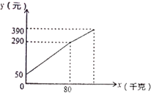

# Mathematics - 题目 2959

**ID**: 524c402d07c94888ab42caec9eb30bf7
**年级**: Grade 7
**难度**: Easy
**题型**: Calculation

## 题目
一水果贩子在批发市场按每千克1.​​​​​​​‌8元批发了若干千克的西瓜进城出售，为了方便，他带了一些零钱备用．他先按市场价售出一些后，又降价出售．售出西瓜千克数 $x$ 与他手中持有的钱数 $y$ 元（含备用零钱）的关系如图所示，结合图象回答下列问题：（1）农民自带的钱是多少？（2）降价前他每千克西瓜出售的价格是多少？（3）随后他按每千克下降0.5元将剩余的西瓜售完，这时他手中的钱（含备用的钱）是390元，问他一共批发了多少千克的西瓜？（4）请问这个水果贩子一共赚了多少钱？

## 解答

1. 解：（1）由图可得农民自带的零钱为50元，
2. （2）降价前他每千克西瓜出售的价格是3元；
3. $(290-50)\div 80=240\div 80=3$ 元，
4. （3）他一共批发了120千克的西瓜；
5. $(390-290)\div (3-0.5)=100\div 2.5=40$ （千克），
6. $80+40=120$ 千克，
7. （4）这个水果贩子一共赚了124元钱
8. $390-120\times 1.8-50=124$ 元，

## 知识点

**中文**:
  - 从函数的图象获取信息

**English**:
  - Extracting Information from Graphs

---
