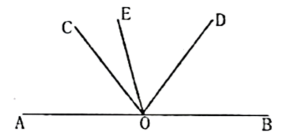

# Mathematics - 题目 238

**ID**: 5bce2a88dbd74613a46a4b7ccad18999
**年级**: Grade 7
**难度**: Easy
**题型**: Calculation

## 题目
如图，点 $O$ 在直线 $AB$ 上， $\angle COD=60{}^\circ ,\angle AOE=2\angle DOE$ ．(1)若 $\angle BOD=60{}^\circ $ ，求 $\angle COE$ 的度数；​​​​​​​‌(2)若 $\angle BOD=x{}^\circ $ ，试猜想 $∠BOD$ 和 $\angle COE$ 的数量关系，并说明理由．

## 解答

1. （1）解：点 $O$ 在直线 $AB$ 上， $\angle BOD=60{}^\circ $ ，
2. 
3. ∴ $\angle AOD=180{}^\circ -\angle BOD=180{}^\circ -60{}^\circ =120{}^\circ $
4. 又∵ $\angle AOE=2\angle DOE$ ，
5. ∴ $\angle DOE=\frac {1}{3}\angle AOD=40{}^\circ $ ，
6. ∵ $\angle COD=60{}^\circ $ ，
7. ∴ $\angle COE=\angle COD-\angle DOE=60{}^\circ -40{}^\circ =20{}^\circ $
8. （2） $∠BOD$ 和 $\angle COE$ 的数量关系是： $\angle BOD=3\angle COE$ ．理由如下：
9. ∵点O在直线 $AB$ 上， $\angle BOD=x{}^\circ $ ，
10. ∴ $\angle AOD=180{}^\circ -\angle BOD=180{}^\circ -x{}^\circ $
11. 又∵ $\angle AOE=2\angle DOE$ ，
12. ∴ $\angle DOE=\frac {1}{3}\angle AOD=\frac {1}{3}(180-x){}^\circ $ ，
13. ∵ $\angle COD=60{}^\circ $ ，
14. ∴ $\angle COE=\angle COD-\angle DOE=60{}^\circ -\frac {1}{3}(180-x){}^\circ =\frac {1}{3}x{}^\circ $
15. 即： $\angle BOD=3\angle COE$ ．

## 知识点

**中文**:
  - 角平分线
  - 角的运算

**English**:
  - Angle Bisector
  - Operations with Angles

---
