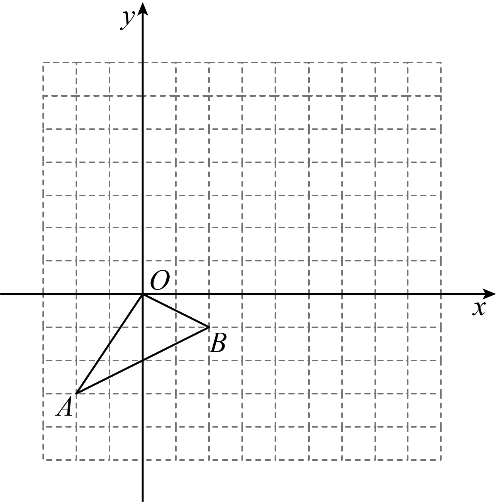

# Mathematics - 题目 2252

**ID**: 67fc40e6658849d5a397dae72f0de12f
**年级**: Grade 7
**难度**: Easy
**题型**: Calculation

## 题目
如图， $\vartriangle ABO$ 中， $A\left ({-2,-3}\right )$ ， $B\left ({2,-1}\right )$ ， $\vartriangle A{^{\prime }}B{^{\prime }}O{^{\prime }}$ 是 $\vartriangle ABO$ 平移之后得到的图形，并且O的对应点 $O^{′}$ 的坐标为 $(5{\rm{，}}4)$ ．(1)作出 $\vartriangle ABO$ 平移之后的图形 $\vartriangle A{^{\prime }}B{^{\prime }}O{^{\prime }}$ ，并写出 $A^{′}{{\rm{、}}}B^{′}$ 两点的坐标分别为；​​​​​​​‌(2)求 $\vartriangle ABO$ 的面积；(3)x轴上有一点Q，使 $\mathrm{△}AOQ$ 的面积与 $\vartriangle ABO$ 相同，求Q坐标．

## 解答

1. （1）解：如图， $\vartriangle A{^{\prime }}B{^{\prime }}O{^{\prime }}$ 为所作， $A^{′}{{\rm{、}}}B^{′}$ 两点的坐标分别为 $\left ({3,1}\right )$ , $\left ({7,3}\right )$ ；
2. 
3. （2）解： $\vartriangle ABO$ 的面积 $=4\times 3-\frac {1}{2}\times 2\times 1-\frac {1}{2}\times 2\times 3-\frac {1}{2}\times 4\times 2=4$ ；
4. （3）解：设Q点的坐标为 $\left ({t,0}\right )$ ，
5. ∵ $\mathrm{△}AOQ$ 的面积与 $\vartriangle ABO$ 相同，
6. ∴ $\frac {1}{2}\times \left |{t}\right |\times 3=4$ ，
7. 解得 $t=\frac {8}{3}$ 或 $t=-\frac {8}{3}$ ，
8. ∴Q点的坐标为 $\left ({-\frac {8}{3},0}\right )$ 或 $\left ({\frac {8}{3},0}\right )$ ．

## 知识点

**中文**:
  - 作图——平移
  - 坐标与图形性质
  - 坐标与图形变化——平移

**English**:
  - Construction: Translation
  - Coordinates and Geometric Properties
  - Coordinates and Translation

---
