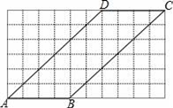

# Mathematics - 题目 3917

**ID**: abd57a50e2c140369297d846ba0b79de
**年级**: Grade 7
**难度**: Easy
**题型**: Calculation

## 题目
如图，在正方形网格中有一边长为4的平行四边形ABCD，请将其剪拼成一个有一边长为6的矩形．（要求：在答题卡的图中画出裁剪线即可）​​​​​​​‌

## 解答

1. 试题分析：如图先过D点向下剪出一个三角形放在平行四边形的左边，再在剪去D点下面两格的小正方形放在右面，就组成了矩形．
2. 试题解析：如图：
3. 

## 知识点

**中文**:
  - 平面图形

**English**:
  - Plane Figures

---
