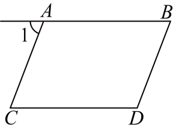

# Mathematics - 题目 3471

**ID**: af3444d4497b44aeaed93b5936f5a42b
**年级**: Grade 7
**难度**: Easy
**题型**: Calculation

## 题目
如图，直线 $AB{\rm{/\mskip-4mu/}}CD$ ， $∠1=70{}^\circ $ ， $\angle D=110{}^\circ $ ，求 $∠B$ 的度数．阅读下面的解答过程，并填空（理由或数学式）．解：∵ $AB{\rm{/\mskip-4mu/}}CD$ （已知），∴ $\angle 1=$ （      ）（      ）．又∵ $∠1=70{}^\circ $ ， $\angle D=110{}^\circ $ （已知），∴ $\angle 1+\angle D\mathrm{=}180{}^\circ $ （等式的性质）．∴ $\angle C+\angle D=180{}^\circ $ （      ）．∴（      ） ${\rm{/\mskip-4mu/}}$ （      ）（      ）．∴ $\angle B=$ （      ）（      ）．∴ $\angle B=70{}^\circ $ ．​​​​​​​‌

## 解答

1. 解：∵ $AB{\rm{/\mskip-4mu/}}CD$ （已知），
2. ∴ $\angle 1=\angle C$ （两直线平行，内错角相等）．
3. 又∵ $∠1=70{}^\circ $ ， $\angle D=110{}^\circ $ （已知），
4. ∴ $\angle 1+\angle D\mathrm{=}180{}^\circ $ （等式的性质）．
5. ∴ $\angle C+\angle D=180{}^\circ $ （ 等量代换 ）．
6. ∴ $AC{\rm{/\mskip-4mu/}}BD$ （ 同旁内角互补，两直线平行）．
7. ∴ $\angle B=\angle 1$ （两直线平行，同位角相等）．
8. ∴ $\angle B=70{}^\circ $ ．

## 知识点

**中文**:
  - 平行线的判定与性质

**English**:
  - Determination and Properties

---
