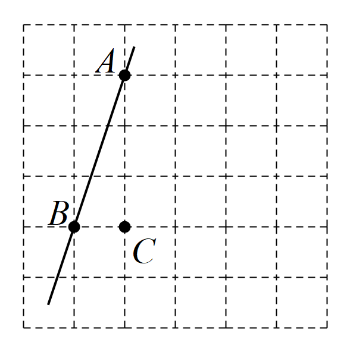

# Mathematics - 题目 3447

**ID**: b780aef104614a2786dce6e4827d408c
**年级**: Grade 7
**难度**: Easy
**题型**: Calculation

## 题目
如图所示的正方形网格，点A、 $B$ 、 $C$ 都在格点上，(1)利用网格作图：①过点 $C$ 画直线 $AB$ 的平行线 $CD$ ，并标出平行线所经过的格点 $D$ ；​​​​​​​‌②过点 $C$ 画直线 $AB$ 的垂线 $CE$ ，并标出垂线所经过的格点 $E$ ，垂足为点 $F$ ；(2)线段的长度是点 $C$ 到直线 $AB$ 的距离；(3)比较大小： $CF$$CB$ (填 $>$ 、 $<$ 或 $=$ )．

## 解答

1. （1）解：①如图， $AB$ 的平行线 $CD$ 即为所求；
2. 
3. ②如图， $AB$ 的垂线 $CE$ 即为所求；
4. 
5. 连接 $DE$ ，勾股定理可得 $CD{^{2}}=CE{^{2}}=1{^{2}}+3{^{2}}=10$ ， $DE{^{2}}=2{^{2}}+4{^{2}}=20$ ，
6. ∴ $CD{^{2}}+CE{^{2}}=DE{^{2}}$
7. ∴ $\angle DCE=90{}^\circ $ ，
8. ∴ $CE\bot CD$ ，
9. ∵ $AB{\rm{/\mskip-4mu/}}CD$ ，
10. ∴ $CE⊥AB$ ；
11. （2）线段 $CF$ 的长度是点 $C$ 到直线 $AB$ 的距离；
12. 故此题答案为： $CF$ ；
13. （3）根据垂线段最短可知： $CF<CB$ ．
14. 故此题答案为： $<$ ．

## 知识点

**中文**:
  - 勾股定理
  - 点到直线的距离
  - 平行线的判定与性质

**English**:
  - Pythagorean Theorem
  - Distance from Point to Line
  - Determination and Properties

---
