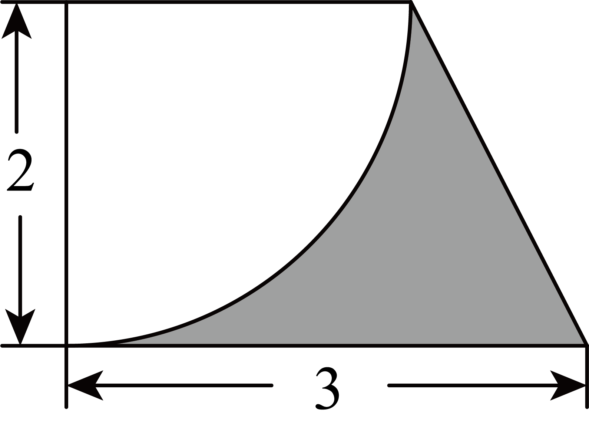

# Mathematics - 题目 695

**ID**: d180f802945a442ba8976757f3554e4a
**年级**: Grade 7
**难度**: Easy
**题型**: Calculation

## 题目
求下图中涂色部分的面积．（单位： ${\rm{c}}{\rm{m}}$ ）​​​​​​​‌

## 解答

1. 解：由题意得：梯形面积为： $\left ({3+2}\right )\times 2\times \frac {1}{2}=5{\rm{c}}{\rm{m}}{^{2}}$ ，
2. 空白的 $\frac {1}{4}$ 圆的面积为： ${\rm{π}}\times 2{^{2}}\times \frac {1}{4}={\rm{π}}{\rm{c}}{\rm{m}}{^{2}}$ ，
3. ∴阴影部分的面积为： $\left ({5-{\rm{π}}}\right )$  ${\rm{c}}{\rm{m}}{^{2}}$ ．

## 知识点

**中文**:

**English**:

---
