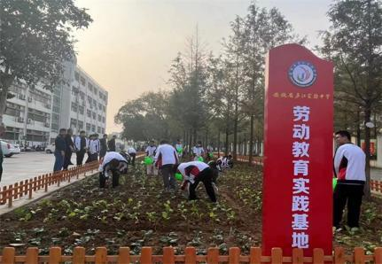

# Mathematics - 题目 687

**ID**: fdc01e70adff4c0581fef44a39caf60b
**年级**: Grade 7
**难度**: Easy
**题型**: Calculation

## 题目
某学校开垦了两块园地当作学生劳动实践活动基地．两块园地中，一块是长方形，另一块是正方形．春季学生在这两块园地内种植同一种蔬菜，若长方形园地每排种植 $(3a+2b)$ 株，种植了 $(a+3b)$ 排，正方形园地每排种植 $(a+b)$ 株，种植了 $(a+b)$ 排（ $a>b>0$ ）．(1)请计算长方形园地种植的蔬菜比正方形园地种植的蔬菜多多少株．(2)当 $a=3$ ， $b=2$ 时，这两块园地一共种植了多少株蔬菜？​​​​​​​‌

## 解答

1. （1）解：由题意得 $\left ({3a+2b}\right )\left ({a+3b}\right )-{\left({a+b}\right)^{2}}$
2. $=3a{^{2}}+9ab+2ab+6b{^{2}}-\left ({a{^{2}}+2ab+b{^{2}}}\right )$
3. $=3a{^{2}}+9ab+2ab+6b{^{2}}-a{^{2}}-2ab-b{^{2}}$
4. $=2a{^{2}}+9ab+5b{^{2}}$ ，
5. 答：长方形园地种植的蔬菜比正方形园地种植的蔬菜多 $\left ({2a{^{2}}+9ab+5b{^{2}}}\right )$ 株；
6. （2）解：由题意得 $\left ({3a+2b}\right )\left ({a+3b}\right )+{\left({a+b}\right)^{2}}$
7. $=3a{^{2}}+9ab+2ab+6b{^{2}}+\left ({a{^{2}}+2ab+b{^{2}}}\right )$
8. $=3a{^{2}}+9ab+2ab+6b{^{2}}+a{^{2}}+2ab+b{^{2}}$
9. $=4a{^{2}}+13ab+7b{^{2}}$ ；
10. 当 $a=3$ ， $b=2$ 时，
11. 原式 $=4\times 3{^{2}}+13\times 3\times 2+7\times 2{^{2}}$
12. $=4\times 9+13\times 3\times 2+7\times 4$
13. $=36+78+28$
14. $=142$ （株），
15. 答：当 $a=3$ ， $b=2$ 时，这两块园地一共种植了 $142$ 株蔬菜．

## 知识点

**中文**:
  - 完全平方公式
  - 整式的混合运算

**English**:
  - Perfect Square Formula
  - Mixed Operations of Polynomials

---
