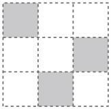

# Mathematics - 题目 1295

**ID**: 011988d930904751b762eab806a807c5
**年级**: Grade 7
**难度**: Easy
**题型**: Fill-in-the-blank

## 题目
如图，在 $3\times 3$ 的正方形网格中，已将部分小正方形涂上阴影，有一只小虫自由地落到网格中，那么小虫落到阴影部分的概率是．​​​​​​​‌

## 解答

1. 解：小虫落到阴影部分的概率 $=\frac {3}{3\times 3}=\frac {1}{3}$ .

## 知识点

**中文**:
  - 几何概率

**English**:
  - Geometric Probability

---
