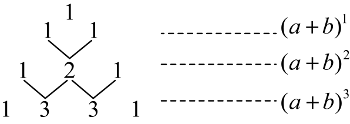

# Mathematics - 题目 2597

**ID**: 016c58e39cc24357beff50797d5531b8
**年级**: Grade 7
**难度**: Easy
**题型**: Fill-in-the-blank

## 题目
我国古代数学中“杨辉三角”非常有名．如图，这个三角形的构造法则：两腰上的数都是1，其余每个数均为其上方左右两数之和，它给出了 $(a+b){^{n}}$ （n为正整数）的展开式（按a的次数由大到小的顺序排序）的系数规律．例如，在三角形中第三行的三个数 $1,2,1$ ，恰好对应 $(a+b){^{2}}=a{^{2}}+2ab+b{^{2}}$ 展开式中的系数，第四行的四个数 $1,3,3,1$ 恰好对应 ${\left({a+b}\right)^{3}}=a{^{3}}+3a{^{2}}b+3ab{^{2}}+b{^{3}}$ 展开式中的系数，利用上述的规律计算：$10{^{5}}+5\times 10{^{4}}+10\times 10{^{3}}+10\times 10{^{2}}+5\times 10+1=$．（结果用幂的形式表示）​​​​​​​‌

## 解答

1. 解：根据题意得 ${\left({a+b}\right)^{5}}=a{^{5}}+5a{^{4}}b+10a{^{3}}b{^{2}}+10a{^{2}}b{^{3}}+5ab{^{4}}+b{^{5}}$ ，
2. 令上式中 $a=10,b=1$ ，得 $10{^{5}}+5\times 10{^{4}}+10\times 10{^{3}}+10\times 10{^{2}}+5\times 10+1={\left({10+1}\right)^{5}}=11{^{5}}$ ．

## 知识点

**中文**:
  - 多项式乘多项式
  - 规律型：数与式的变化类

**English**:
  - Polynomial times Polynomial
  - Patterns: Number and Expression Variations

---
