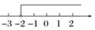

# Mathematics - 题目 896

**ID**: 0c2be4c16ffd47f0aadd097dd64770c5
**年级**: Grade 7
**难度**: Easy
**题型**: Fill-in-the-blank

## 题目
某不等式的解集在数轴上的表示如图所示，则该不等式的解集是．​​​​​​​‌

## 解答

1. 解：观察数轴得到不等式的解都在 $-2$ 的右侧，
2. ∴不等式的解集为： $x>-2$ ；
3. 故答案为 $x>-2$ ．

## 知识点

**中文**:
  - 不等式的解集
  - 在数轴上表示不等式的解集

**English**:
  - Solution Set of Inequalities
  - Representing Solution Sets on Number Line

---
