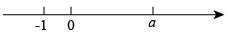

# Mathematics - 题目 2292

**ID**: 1f5fc0289c234b25b600aa51e7bb9588
**年级**: Grade 7
**难度**: Easy
**题型**: Fill-in-the-blank

## 题目
有理数a在数轴上的对应点的位置如图所示，化简|1﹣a|﹣|a|的结果是．​​​​​​​‌

## 解答

1. 解：由题意可得a＞1，
2. ∴|1﹣a|﹣|a| ${\rm ＝\mathit{a}}$ ﹣1﹣a＝﹣1.
3. 【知识点拨】正数的绝对值是他本身，负数的绝对值是它的相反数，0的绝对值是0．

## 知识点

**中文**:
  - 利用数轴比较有理数的大小
  - 化简绝对值

**English**:
  - Comparing Rational Numbers Using Number Line
  - Simplifying Absolute Value Expressions

---
