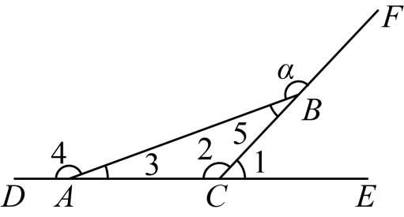

# Mathematics - 题目 3419

**ID**: 2e15438c54414dd3927fdfc577c67bcc
**年级**: Grade 7
**难度**: Easy
**题型**: Fill-in-the-blank

## 题目
将图中的角用不同方法表示出来，填写下表：$\angle 1$$\angle 3$$\angle 4$$\angle α$$∠ABC$$\angle BCA$​​​​​​​‌

## 解答

1. 解：
2. $\angle 1$
3. $\angle 5$
4. $\angle 3$
5. $\angle 4$
6. $\angle 2$
7. $\angle α$
8. $\angle FCE$
9. $∠ABC$
10. $∠BAC$
11. $∠DAB$
12. $\angle BCA$
13. $\angle ABF$
14. 故答案为： $\angle FCE,\angle 5,\angle BAC,\angle DAB,\angle 2,\angle ABF$ ．

## 知识点

**中文**:
  - 角的表示方法

**English**:
  - Representation of Angles

---
