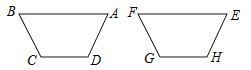

# Mathematics - 题目 1314

**ID**: 335ffad92e9e4396b3be3989d4367a3b
**年级**: Grade 7
**难度**: Easy
**题型**: Fill-in-the-blank

## 题目
如图，四边形EFGH与四边形ABCD是全等图形，若AD=5，∠B=70°．则 EH=，∠F=．​​​​​​​‌

## 解答

1. ∵四边形EFGH与四边形ABCD是全等图形，AD=5，∠B=70°，
2. ∴EH=AD=5，∠F=∠B=70°，
3. 故答案为5，70°．

## 知识点

**中文**:
  - 图形的全等

**English**:
  - Congruence of Figures

---
