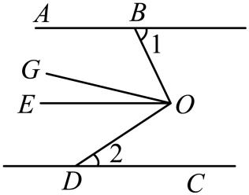

# Mathematics - 题目 2886

**ID**: 4000c39c868d47048a63e7b987bfbd01
**年级**: Grade 7
**难度**: Easy
**题型**: Fill-in-the-blank

## 题目
如图，已知 $AB{\rm{/}}{\rm{/}}DC{\rm{/}}{\rm{/}}EO$ ， $∠1=70{}\degree $ ， $\angle 2=30{}\degree $ ， $OG$ 平分 $\angle BOD$ ，则 $\mathrm{∠}EOG=$．​​​​​​​‌

## 解答

1. 解：∵AB∥OE∥CD
2. ∴ ${\rm ∠1=∠\mathit{BOE=}70°，∠2=∠\mathit{EOD}=30°}$
3. ∴ ${\rm ∠\mathit{BOD}=∠\mathit{EOD}+∠\mathit{EOB}=100°}$
4. ∵OG平分 ${\rm ∠\mathit{BOD}}$
5. ∴ ${\rm ∠\mathit{BOG}=}\frac {1}{2}∠BOD{\rm =50°}$
6. ∴ ${\rm ∠\mathit{GOE}=∠\mathit{EOD}-∠\mathit{BOG}=20°}$

## 知识点

**中文**:
  - 两直线平行内错角相等

**English**:
  - Parallel Lines have Equal Alternate Interior Angles

---
