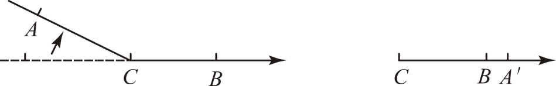

# Mathematics - 题目 702

**ID**: 40e9c503d82e4828bc1639c679100df1
**年级**: Grade 7
**难度**: Easy
**题型**: Fill-in-the-blank

## 题目
一条数轴上有点A、 $B$ 、 $C$ ，其中点A、 $B$ 表示的数分别是 $-17$ 、8，现以点 $C$ 为折点，将数轴向右对折，若点A对应的点 $A^{′}$ 落在点 $B$ 的右边， $A^{′}B=3$ ，则 $C$ 点表示的数是．​​​​​​​‌

## 解答

1. 解：∵点 $B$ 表示的数是8，点 $A^{′}$ 落在点 $B$ 的右边， $A^{′}B=3$ ，
2. ∴点 $A^{′}$ 表示的数是： $8+3=11$
3. 由折叠可知：点 $C$ 为 $AA^{′}$ 的中点，
4. ∵点A表示的数是 $-17$ ，
5. ∴ $C$ 点表示的数是： $\frac {-17+11}{2}=-3$
6. 故此题答案为： $-3$ ．

## 知识点

**中文**:
  - 数轴上两点之间的距离
  - 用数轴上的点表示有理数

**English**:
  - Distance Between Two Points on Number Line
  - Representing Rational Numbers on Number Line

---
