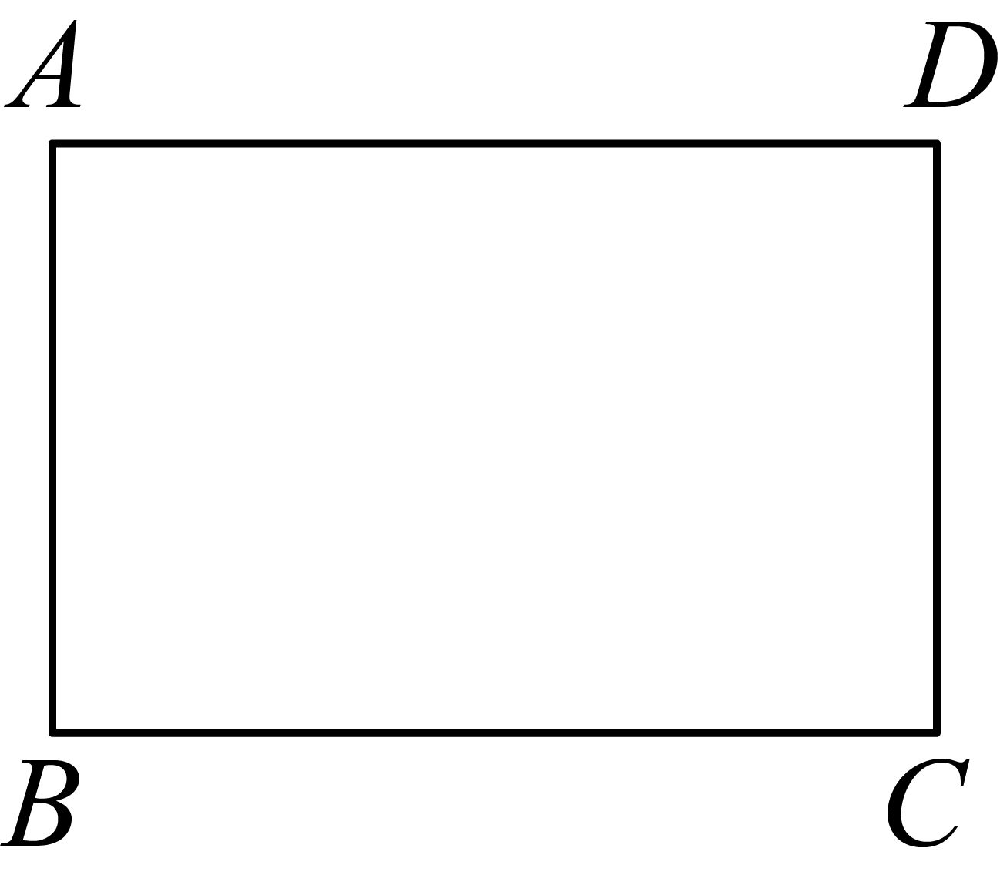

# Mathematics - 题目 2915

**ID**: 556b39789ee0451c80b2cd6e01975baf
**年级**: Grade 7
**难度**: Easy
**题型**: Fill-in-the-blank

## 题目
如图，B所表示的点为 $\left ({2,2}\right ){\rm ，\mathit{C}}$ 表示的点为 $\left ({5,2}\right )$ ，并且长方形的面积为6，则点D可以表示为．​​​​​​​‌

## 解答

1. 解：根据题意，得 $BC=5-2=3$ ，由长方形的面积为6，得到 $AB\cdot BC=6$ ，
2. 得到 $AB=CD=2$ ，
3. 故 $D\left ({5,4}\right )$ ．

## 知识点

**中文**:
  - 坐标与图形性质

**English**:
  - Coordinates and Geometric Properties

---
