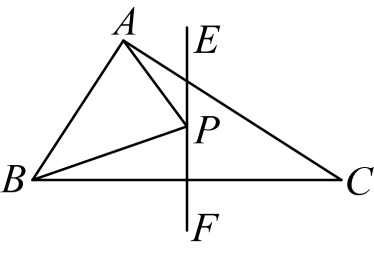

# Mathematics - 题目 3158

**ID**: a60dc848144d4b078f806345e3c3246a
**年级**: Grade 7
**难度**: Easy
**题型**: Fill-in-the-blank

## 题目
如图，在 $\vartriangle ABC$ 中， $AB=3$ ， $AC=4$ ， $EF$ 垂直平分线段 $BC{\rm ，\mathit{P}}$ 是直线 $EF$ 上的任意一点，则 $\vartriangle ABP$ 周长的最小值是．​​​​​​​‌

## 解答

1. 解：如图，连接 $PC$ ，
2. 
3. ∵ $EF$ 垂直平分线段 $BC$ ，
4. $\therefore PB=PC$ ，
5. $\therefore PA+PB=PA+PC\geqslant AC=4$ ，
6. $\therefore PA+PB$ 的最小值为4，
7. $\therefore \vartriangle ABP$ 的周长的最小值为 $3+4=7$ .

## 知识点

**中文**:
  - 三角形三边关系
  - 线段垂直平分线的性质

**English**:
  - Relationship Between Sides
  - Properties of Perpendicular Bisectors

---
