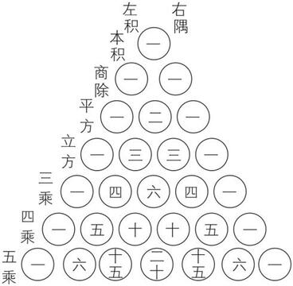

# Mathematics - 题目 931

**ID**: d0b49d3a7254449cb8888b6580bd2c7d
**年级**: Grade 7
**难度**: Easy
**题型**: Fill-in-the-blank

## 题目
文化欣赏我国南宋时期数学家杨辉于1261年写下《详解九章算法》,书中记载的二项和的乘方 ${\left(a+b\right)^{n}}$ 展开式的系数规律如图所示，其中“三乘”对应的展开式： ${\left(a+b\right)^{4}}={a}^{4}+4{a}^{3}b+6{a}^{2}{b}^{2}+4a{b}^{3}+{b}^{4}$ .​​​​​​​‌应用体验已知 ${\left(x+2\right)^{4}}={x}^{4}+m{x}^{3}+24{x}^{2}+32x+16$ ,则 $m$ 的值为.

## 解答

1. 由题意可得 ${\left(x+2\right)^{4}}={x}^{4}+4{x}^{3}×2+6{x}^{2}×{2}^{2}+4x×{2}^{3}+{2}^{4}={x}^{4}+8{x}^{3}+24{x}^{2}+32x+16$ ， $\therefore m{x}^{3}=8{x}^{3}$ ， $\therefore m=8$ .

## 知识点

**中文**:
  - 多项式乘多项式
  - 规律型：数与式的变化类

**English**:
  - Polynomial times Polynomial
  - Patterns: Number and Expression Variations

---
