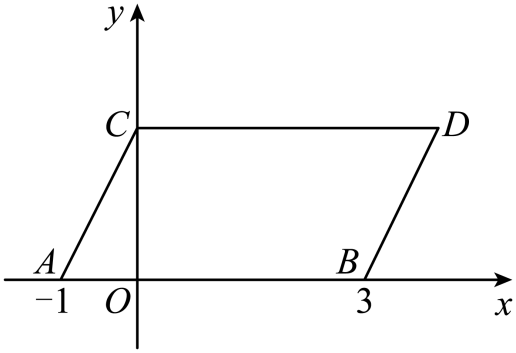

# Mathematics - 题目 3211

**ID**: d68de169af4c43f4aa8c49e0e35484ea
**年级**: Grade 7
**难度**: Easy
**题型**: Fill-in-the-blank

## 题目
如图，在平面直角坐标系中，点 $A$ ， $B$ 的坐标分别为 $\left ({-1,0}\right )$ ， $\left ({3,0}\right )$ ．现将线段 $AB$ 向上平移 $2$ 个单位，再向右平移 $1$ 个单位，得到线段 $AB$ 的对应线段 $CD$ ，连接 $AC$ ， $BD$ ．若在 $y$ 轴上存在一点 $P$ ，连接 $PA$ ， $PB$ ，且 $\vartriangle PAB$ 的面积是 $\vartriangle AOC$ 面积的 $2$ 倍，则满足条件的所有点 $P$ 的坐标．​​​​​​​‌

## 解答

1. ∵点 $A$ ， $B$ 的坐标分别为 $\left ({-1,0}\right )$ ， $\left ({3,0}\right )$ ．现将线段 $AB$ 向上平移 $2$ 个单位，再向右平移 $1$ 个单位，
2. $\therefore $  $C\left ({0,2}\right )$  $,$
3. 则 $S{{}_{\vartriangle AOC}}=\frac {1}{2}\times OA\times OC=\frac {1}{2}\times 1\times 2=1$
4. $\because $  $\vartriangle PAB$ 的面积是 $\vartriangle AOC$ 面积的 $2$ 倍，
5. $\therefore $  $S{{}_{\vartriangle PAB}}=2$ ，
6. 设点 $P$ 到 $AB$ 的距离为 $h$ ，则 $S{{}_{\vartriangle PAB}}=$  $\frac {1}{2}$  $\times AB\times h=2h$ ，
7. $\because S{{}_{\vartriangle PAB}}=2$ ，
8. $\therefore 2h=2$ ，
9. 解得： $h=1$ ，
10. $\therefore P(0$ ， $1)$ 或 $(0$ ， $-1)$ ．

## 知识点

**中文**:
  - 坐标与图形变化——平移
  - 坐标与图形性质
  - 点到直线的距离

**English**:
  - Coordinates and Translation
  - Coordinates and Geometric Properties
  - Distance from Point to Line

---
