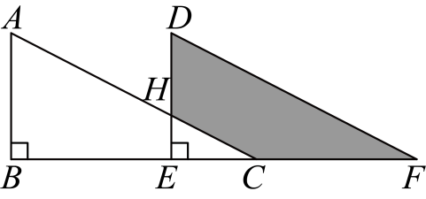

# Mathematics - 题目 2349

**ID**: 000709333bed480398af704215e5728d
**年级**: Grade 7
**难度**: Easy
**题型**: Multiple-choice

## 题目
如图， $\mathrm{△}ABC$ 沿着点 $B$ 到点 $C$ 的方向平移到 $\mathrm{△}DEF$ 的位置， $\angle B=90{}\degree $ ， $AB=6$ ， $DH=4$ ，平移距离为7，则阴影部分的面积为（      ）​​​​​​​‌

## 解答

1. 由平移的性质得 $BE=7$ ， $DE=AB=6$ ， $\angle DEF=\angle B=90{}\degree $ ， $S{{}_{\mathrm{△}ABC}}=S{{}_{\mathrm{△}DEF}}$ ，
2. ∵ $DH=4$ ，
3. ∴ $EH=DE-DH=2$ ，
4. 则阴影部分的面积为 $S{{}_{\mathrm{△}DEF}}-S{{}_{\mathrm{△}HEC}}=S{{}_{\mathrm{△}ABC}}-S{{}_{\mathrm{△}HEC}}$
5. $=S{{}_{直角梯形ABEH}}$
6. $=\frac {\left ({EH+AB}\right )\cdot BE}{2}$
7. $=\frac {\left ({2+6}\right )\times 7}{2}$
8. $=28$ ．
9. 故选C．

## 知识点

**中文**:
  - 平移的性质
  - 梯形

**English**:
  - Properties of Translation
  - Trapezoids

---
