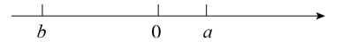

# Mathematics - 题目 3321

**ID**: 04946cd37adf449ab9550a057f85cfa3
**年级**: Grade 7
**难度**: Easy
**题型**: Multiple-choice

## 题目
有理数 $a$ ， $b$ 在数轴上的位置如图所示，则下面关系中，错误的个数为（      ）① $a-b\mathrm{>}0$ ；​​​​​​​‌② $a+b>0$ ；③ $-\left |{b}\right |>-\left |{a}\right |$ ；④ $b-a>0$ ；

## 解答

1. 解：根据数轴可得 $b<0<a$ ， $\left |{b}\right |>\left |{a}\right |$ ，
2. ∴ $a-b\mathrm{>}0$ ， $a+b\mathrm{<}0$ ， $-\left |{b}\right |<-\left |{a}\right |$ ， $b-a\mathrm{<}0$ ，
3. 因此①正确，②错误，③错误，④错误，
4. 本题错误的个数有3个，
5. 故此题答案为C．

## 知识点

**中文**:
  - 利用数轴比较有理数的大小
  - 化简绝对值
  - 有理数的加法法则
  - 有理数的减法

**English**:
  - Comparing Rational Numbers Using Number Line
  - Simplifying Absolute Value Expressions
  - Rules for Addition of Rational Numbers
  - Subtraction of Rational Numbers

---
