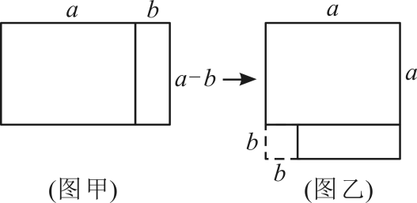

# Mathematics - 题目 3685

**ID**: 2b7892820c0444f0be3144836ce24b00
**年级**: Grade 7
**难度**: Easy
**题型**: Multiple-choice

## 题目
如图，从图甲到图乙的变换过程中，能表示两个图形面积关系的等式是（      ）​​​​​​​‌

## 解答

1. 解：图甲的面积可以看作一个长方形，
2. ∴面积为 $(a+b)(a-b)$ ，
3. 图乙可以看作两个正方形的面积差，
4. 即 $a{^{2}}-b{^{2}}$ ，
5. $\because $ 两个图的面积相等，
6. $\therefore a{^{2}}-b{^{2}}=(a+b)(a-b)$ ，
7. 故选D．

## 知识点

**中文**:
  - 平方差公式与几何图形

**English**:
  - Difference of Squares and Geometric Figures

---
