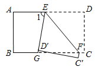

# Mathematics - 题目 17

**ID**: 51d1db5dfc7347518775ef31464330be
**年级**: Grade 7
**难度**: Easy
**题型**: Multiple-choice

## 题目
如图，把一张长方形纸片 $ABCD$ 沿 $EF$ 折叠后，点 $C，D$ 分别落在 $C^{′}，D^{′}$ 的位置上， $ED^{′}$ 的延长线与 $BC$ 的交点为 $G,$ 若 $\angle EFG=50{}^\circ $ ，那么 $\angle 1=$ （      ）​​​​​​​‌

## 解答

1. 解：∵四边形ABCD是矩形，
2. ∴AD∥BC，
3. ∴∠DEF＝∠EFG＝50°，
4. 由折叠得到∠GEF＝∠DEF＝50°，
5. ∴∠GED＝∠GEF＋∠DEF＝100°，
6. 则∠1＝180°−∠GED＝80°．
7. 故此题答案为D．

## 知识点

**中文**:
  - 平行线性质的应用
  - 折叠问题

**English**:
  - Applications of Properties
  - Folding Problems

---
