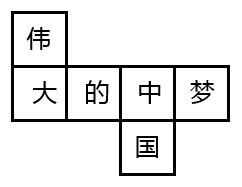

# Mathematics - 题目 1986

**ID**: 632cd0bb3e5742e7bf0c987a828b3187
**年级**: Grade 7
**难度**: Easy
**题型**: Multiple-choice

## 题目
如图，是一个正方体的表面展开图，则原正方体中“伟”字所在的面相对的面上标的字是（      ）​​​​​​​‌

## 解答

1. ∵ 正方体的表面展开图中相对的面之间一定相隔一个正方形，
2. ∴ 原正方体中与“伟”字所在的面相对的面上标的字是“国”，
3. 故此题答案为C．

## 知识点

**中文**:
  - 几何体的展开图

**English**:
  - Nets of Geometric Solids

---
