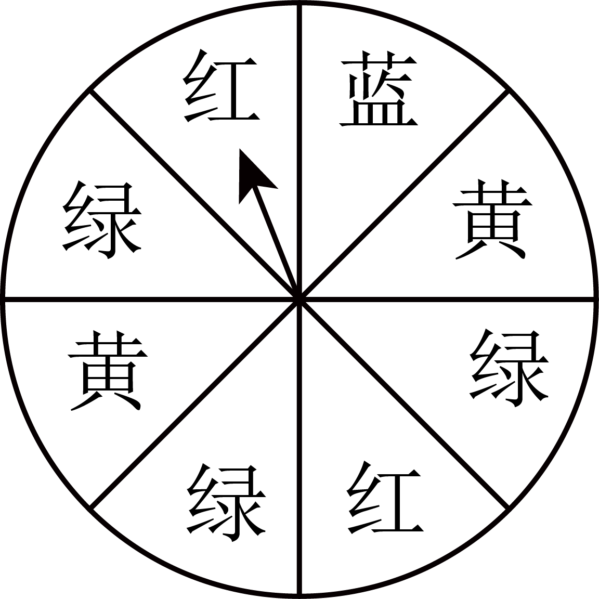

# Mathematics - 题目 3561

**ID**: 7a7dd2a647c840f6918c4a99418e5c67
**年级**: Grade 7
**难度**: Easy
**题型**: Multiple-choice

## 题目
如图，把一个均匀的圆形转盘等分成8份，在每一份上涂上红、黄、蓝、绿四种颜色中的一种，再安装上指针，设计成一个“幸运大转盘”．任意转动转盘，指针停留在哪个区域的可能性最大？（      ）​​​​​​​‌

## 解答

1. 解：由图，得
2. 指针停留在红色区域的可能性为 $\frac {2}{8}=\frac {1}{4}$ ，
3. 指针停留在黄色区域的可能性为 $\frac {2}{8}=\frac {1}{4}$ ，
4. 指针停留在蓝色区域的可能性为 $\frac {1}{8}$ ，
5. 指针停留在绿色区域的可能性为 $\frac {3}{8}$ ，
6. 由 $\frac {1}{8}<\frac {1}{4}<\frac {3}{8}$ ，得
7. 任意转动转盘，指针停留在绿色区域的可能性最大．
8. 故选D．

## 知识点

**中文**:
  - 可能性的大小

**English**:
  - Likelihood

---
