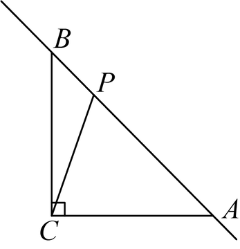

# Mathematics - 题目 1302

**ID**: 93661318dcbb4216bc35ef383ad6113d
**年级**: Grade 7
**难度**: Easy
**题型**: Multiple-choice

## 题目
如图， $\angle ACB\mathrm{=}90{}\degree $ ， $AC=6$ ， $BC=8$ ， $AB=10$ ， $P$ 为直线 $AB$ 上一动点，连接 $PC$ ，则线段 $PC$ 的最小值是（      ）​​​​​​​‌

## 解答

1. 解：∵点到直线的距离，垂线段最短，
2. ∴当 $PC\bot AB$ 时， $PC$ 的值最小，
3. 在 ${\rm{R}}{\rm{t}}\mathrm{△}ABC$ 中，
4. ∵ $\angle ACB\mathrm{=}90{}\degree $ ， $AC=6$ ， $BC=8$ ， $AB=10$ ，
5. ∴ $\frac {1}{2}AB\cdot PC=\frac {1}{2}AC\cdot BC$ ，即： $10PC=6\times 8$ ，
6. ∴ $PC=4.8$ ，
7. 故选B．

## 知识点

**中文**:
  - 垂线段最短

**English**:
  - Shortest Perpendicular Segment

---
