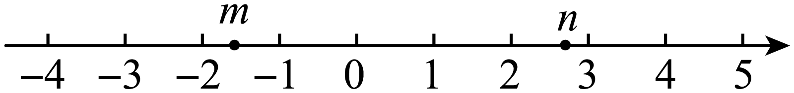

# Mathematics - 题目 2985

**ID**: a77ea1282cd14176bbf2a8b747e4d6ce
**年级**: Grade 7
**难度**: Easy
**题型**: Multiple-choice

## 题目
有理数m，n在数轴上的对应点的位置如图所示，则不正确的结论是（      ）​​​​​​​‌

## 解答

1. 由图可知：－2＜m＜－1＜2＜n＜3．
2. A．m＜﹣1，故本选项错误，符合题意；
3. B．|m|＜|n|且m＜0＜n，则m＞﹣n，故本选项正确，不符合题意；
4. C．m＜0＜n，则mn＜0，故本选项正确，不符合题意；
5. D．|m|＜|n|且m＜0＜n，∴ $m+n＞0$ ，故本选项正确，不符合题意．
6. 
7. 故此题答案为A．

## 知识点

**中文**:
  - 利用数轴比较有理数的大小
  - 有理数的加法法则
  - 有理数的乘法法则

**English**:
  - Comparing Rational Numbers Using Number Line
  - Rules for Addition of Rational Numbers
  - Rules for Multiplication of Rational Numbers

---
