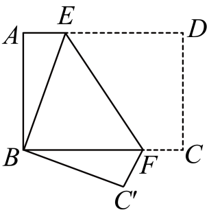

# Mathematics - 题目 2365

**ID**: b8afd5d70d47499e85b4b8a9fd5cf510
**年级**: Grade 7
**难度**: Easy
**题型**: Multiple-choice

## 题目
如图，将长方形纸片 $ABCD$ 折叠，使点D与B点重合，点C落在 $C^{′}$ 点处，折痕为 $EF$ ．若 $\angle ABE=20{}\degree $ ，那么 $\angle EFB$ 的度数为（      ）​​​​​​​‌

## 解答

1. 解：∵长方形纸片 $ABCD$ ，
2. ∴ $AD{\rm{/\mskip-4mu/}}BC$ ， $\angle ABC=90{}\degree $ ，
3. ∴ $\angle EBF=\angle ABC-\angle ABE=70{}\degree $ ， $\angle AEB=\angle EBF=70{}\degree $ ， $\angle EFB=\angle DEF$ ，
4. 由折叠可得， $\angle BEF=\angle DEF$ ，
5. ∴ $\angle BEF=\angle DEF=\frac {180{}\degree -\angle AEB}{2}=55{}\degree $ ，
6. ∴ $\angle EFB=55{}\degree $
7. 故此题答案为C．

## 知识点

**中文**:
  - 平行线性质的应用
  - 折叠问题

**English**:
  - Applications of Properties
  - Folding Problems

---
