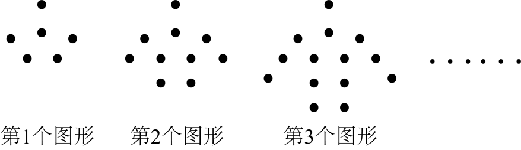

# Mathematics - 题目 1235

**ID**: c7d8cc1cb2884181b8a1ea08177787dc
**年级**: Grade 7
**难度**: Easy
**题型**: Multiple-choice

## 题目
将一些完全相同的“●”按如图所示的规律摆放，第1个图形有6个“●”，第2个图形有10个“●”，第3个图形有14个“●”，……按此规律，则第666个图形中“●”的个数是（      ）​​​​​​​‌

## 解答

1. 根据题意，得第一个图形的数量为 $6=\left ({2\times 1+1}\right )\times 2$ ，
2. 第2个图形的数量为 $10=\left ({2\times 2+1}\right )\times 2$ ，
3. 第3个图形的数量为 $14=\left ({2\times 3+1}\right )\times 2$ ，
4. 故666个图形的数量为 $\left ({2\times 666+1}\right )\times 2=2666$ ，
5. 故此题答案为C．

## 知识点

**中文**:
  - 规律型：图形的变化类

**English**:
  - Patterns: Geometric Variations

---
