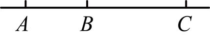

# Mathematics - 题目 3446

**ID**: cabdcfb34b8d4465b76df5ceb51e76d7
**年级**: Grade 7
**难度**: Easy
**题型**: Multiple-choice

## 题目
如图，A，B，C三点在同一水平线上，则下列说法不正确的是（      ）​​​​​​​‌

## 解答

1. 解：A、直线 $AB$ 与直线 $BC$ 是同一条直线，此选项说法正确，不符合题意；
2. B、线段 $AC$ 与线段 $CA$ 是同一条线段，此选项说法正确，不符合题意；
3. C、射线 $AB$ 与射线 $BA$ 不是同一条射线，此选项说法不正确，符合题意；
4. D、射线 $CA$ 与射线 $CB$ 的起点相同，是同一条射线，此选项说法正确，不符合题意．
5. 故此题答案为C．

## 知识点

**中文**:
  - 直线、射线、线段的定义

**English**:
  - Definitions

---
