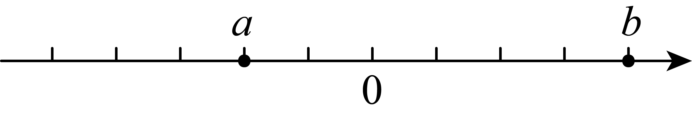

# Mathematics - 题目 3833

**ID**: fa98085e41d741b3bfd52197ceac1375
**年级**: Grade 7
**难度**: Easy
**题型**: Multiple-choice

## 题目
有理数a，b在数轴上对应点的位置如图所示，下列说法中正确的是（      ）​​​​​​​‌

## 解答

1. 解：由数轴可知， $a<0<b$ ， $\left |{a}\right |<\left |{b}\right |$ ，
2. $\therefore -a<b$ ， $a+b>0$ ，
3. $\therefore $ 只有D选项正确，
4. 故选D．

## 知识点

**中文**:
  - 利用数轴比较有理数的大小
  - 相反数的几何意义
  - 绝对值的几何意义

**English**:
  - Comparing Rational Numbers Using Number Line
  - Geometric Meaning of Opposite Numbers
  - Geometric Meaning of Absolute Value

---
