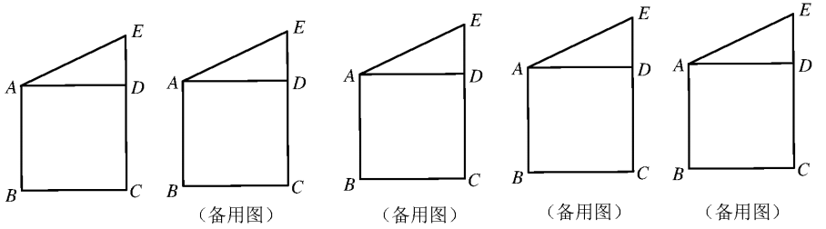

# Mathematics - 题目 1119

**ID**: 0b562b1a8b9845868976fe18df10135e
**年级**: Grade 7
**难度**: Medium
**题型**: Calculation

## 题目
如图，正方形 $ABCD$ 中，点E是线段 $CD$ 延长线一点，连接 $AE$ ， $AB=m$ ， $DE=n$ ．(1)将 $\vartriangle ADE$ 绕着点A旋转，使得 $AD$ 与 $AB$ 重合，点E落在点F处，连接 $EF$ ，用代数式表示 $\mathrm{△}CEF$ 的面积；​​​​​​​‌(2)将 $\vartriangle ADE$ 绕平面内某一点顺时针旋转，使旋转后的三角形有一边与正方形的一边完全复合，画出符合条件的情况(第(1)小题的情况除外)，并写出旋转中心、旋转角．

## 解答

1. （1）解：由题意得 $EC=m+n$ ， $FC=m-n$ ，
2. ∴ $\mathrm{△}CEF$ 的面积 $\frac {1}{2}\cdot EC\cdot FC=\frac {1}{2}(m+n)(m-n)=\frac {1}{2}m{^{2}}-\frac {1}{2}n{^{2}}$ ，
3. 
4. 故答案为 $\frac {1}{2}\left ({m{^{2}}-n{^{2}}}\right )$ ；
5. （2）①如图，旋转中心： $AD$ 边的中点为O，顺时针 $180{}\degree $ ，
6. ；
7. ②如图，旋转中心：点D，顺时针旋转 $270{}\degree $ ，
8. ；
9. ③如图，旋转中心：正方形对角线交点G，顺时针旋转 $90{}\degree $ ，
10. ；
11. ④如图，旋转中心：正方形对角线交点G，顺时针旋转 $180{}\degree $ .
12. ．

## 知识点

**中文**:
  - 旋转三要素
  - 旋转的性质

**English**:
  - Three Elements of Rotation
  - Properties of Rotation

---
