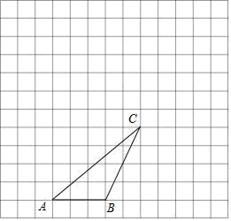

# Mathematics - 题目 3334

**ID**: 28370bd8ec7748b8af412159a204e5c5
**年级**: Grade 7
**难度**: Medium
**题型**: Calculation

## 题目
如图，在边长为1个单位长度的小正方形组成的方格纸中，△ABC的顶点都在方格纸的格点上．（1）①将△ABC向右平移2个单位，得到△A_{1}B_{1}C_{1}．请画出△A_{1}B_{1}C_{1}；​​​​​​​‌②将△A_{1}B_{1}C_{1}再向上平移5个单位得△A_{2}B_{2}C_{2}，请画出△A_{2}B_{2}C_{2}；（2）求△ABC的面积．

## 解答

1. （1）解：如图，△A_{1}B_{1}C_{1}_{、}△A_{2}B_{2}C_{2}为所作；
2. 
3. （2）根据题意，可得△ABC的底是3，高是4，
4. ∴△ABC的面积＝ $\frac {1}{2}$ ×3×4＝6

## 知识点

**中文**:
  - 作图——平移
  - 平移的性质

**English**:
  - Construction: Translation
  - Properties of Translation

---
