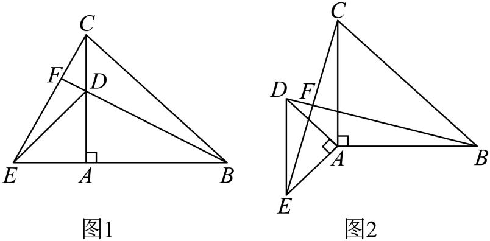

# Mathematics - 题目 780

**ID**: 34ce792fdbd54766880c3acc9ae6fd2a
**年级**: Grade 7
**难度**: Medium
**题型**: Calculation

## 题目
以点A为顶点作两个等腰直角三角形（ $\vartriangle ABC$ ， $\vartriangle ADE$ ），如图1所示放置，使得一直角边重合，连接 $BD$ ， $CE$ ．(1)说明 $BD=CE$ ；​​​​​​​‌(2)延长 $BD$ ，交 $CE$ 于点F，求证： $BD\bot CE$ ；(3)若如图2放置，上面的结论还成立吗？请说明理由．

## 解答

1. （1）证明：在 $\vartriangle ADB$ 和 $\mathrm{△}AEC$ 中，
2. $\begin{cases}AD=AE\\\angle DAB=\angle EAC=90{}\degree \\AB=AC\end{cases}$ ，
3. ∴ $\vartriangle ADB≌\vartriangle AEC\left ({{\rm{S}}{\rm{A}}{\rm{S}}}\right )$ ，
4. ∴ $BD=CE$ ；
5. （2）解：∵ $△ADB\mathrm{≌}△AEC$ ，
6. ∴ $\angle DBA=\angle ECA$ ，
7. ∵ $\angle BDA=\angle CDF$ ，
8. ∴ $\angle BFC=180{}\degree -\angle ACE-\angle CDF=180{}\degree -\angle DBA-\angle BDA=\angle DAB=90{}\degree $ ，
9. ∴ $BD\bot CE$ ；
10. （3）证明： $BD\bot CE$ ， $BD=CE$ 成立，
11. 理由如下：∵ $\vartriangle ABC$ ， $\vartriangle ADE$ 是等腰直角三角形，
12. ∴ $AB=AC,AD=AE,\angle BAC=\angle EAD=90{}\degree $ ，
13. ∴ $\angle BAC+\angle CAD=\angle EAD+\angle CAD$ ，即 $\angle BAD=\angle CAE$ ，
14. 在 $\vartriangle ADB$ 和 $\mathrm{△}AEC$ 中，
15. $\begin{cases}AD=AE\\\angle DAB=\angle EAC\\AB=AC\end{cases}$ ，
16. ∴ $\vartriangle ADB≌\vartriangle AEC\left ({{\rm{S}}{\rm{A}}{\rm{S}}}\right )$ ，
17. ∴ $\angle ABF=\angle ACF$ ， $BD=CE$
18. ∴ $\angle BFC=\angle BAC=90{}\degree $ ，
19. ∴ $BD\bot CE$ ， $BD=CE$ ．

## 知识点

**中文**:
  - 全等三角形的判定与性质
  - 等腰直角三角形的性质

**English**:
  - Determination and Properties
  - Properties of Isosceles Right Triangles

---
