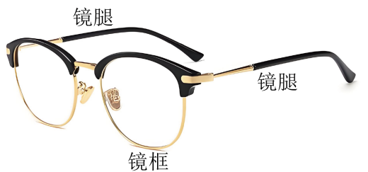

# Mathematics - 题目 486

**ID**: 3de83258253d43fe9d152a1914b49cd5
**年级**: Grade 7
**难度**: Medium
**题型**: Calculation

## 题目
完成如下项目式学习表情境挖掘眼镜是由镜片和镜架组合起来，用来改善视力、保护眼睛或作装饰用途的用品．苏州（姑苏）是中国眼镜的发源地，明代崇祯初年（ $1628$ ），苏州眼镜技师孙云球将制造眼镜技术进一步发扬光大．索材整合某工厂需要生产一批镜架（如图），每副镜架由一个镜框和两个镜腿组装而成．工厂现共有 $45$ 名工人，平均每人每天生产 $100$ 个镜框或 $160$ 个镜腿．任务解决任务一：应如何分配工人才能使每天生产的镜框和镜腿恰好配套？任务二：若每副镜架的成本为 $80$ 元，要达到 $30\%$ 的利润率（利润率 $=$ 利润 $\div $ 成本），则每副镜架的出厂价应定为多少元？​​​​​​​‌

## 解答

1. 解：（1）设 $x$ 名工人生产镜框，则 $\left ({45-x}\right )$ 名工人生产镜腿．
2. 由题意，得 $2\times 100x=160\left ({45-x}\right )$ ，
3. 解方程，得 $x=20$ ．
4. $45-x=45-20=25$ ．
5. 答：每天分配 $20$ 名工人生产镜框， $25$ 名工人生产镜腿恰好配套．
6. （2） $80\times \left ({1+30\%}\right )=104$ （元）．
7. 答：要达到 $30\%$ 的利润率，每副镜架的出厂价应定为 $104$ 元．

## 知识点

**中文**:
  - 配套问题
  - 销售盈亏问题

**English**:
  - Matching Problems
  - Profit and Loss Problems

---
