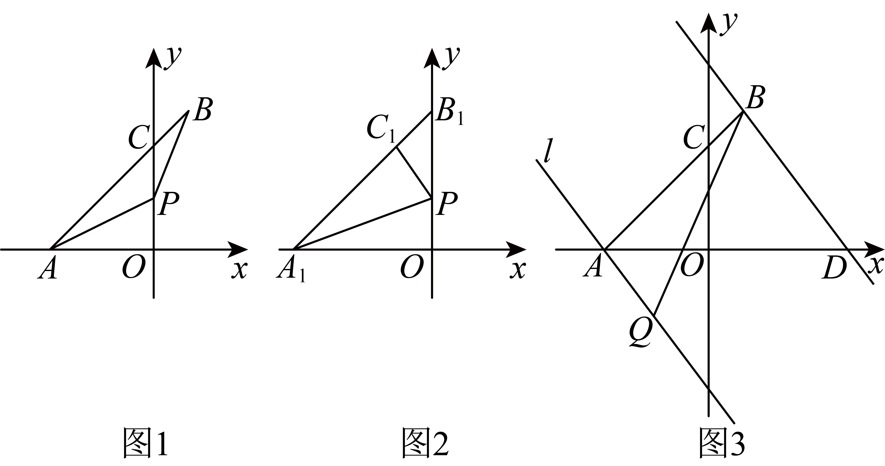

# Mathematics - 题目 393

**ID**: 589389a238884775911f114270e4b219
**年级**: Grade 7
**难度**: Medium
**题型**: Calculation

## 题目
在平面直角坐标系中，线段 ${\rm \mathit{AB}}$ 上有一点 ${\rm \mathit{C}}$ ，已知 $A(a,0),B(1,b),C(0,3)$ ， $a$ ， $b$ 满足 $\left |{a+3}\right |+{\left({b-4}\right)^{2}}=0$ ．(1)如图1，若点 $P\left ({0,m}\right )$ 在线段 $OC$ 上，且三角形 $ABP$ 的面积为 $3$ ，求点 $P$ 的坐标；​​​​​​​‌(2)如图2，将（1）中线段 $AB$ 水平向左平移一个单位，得到线段 $A{{}_{1}}B{{}_{1}}$ ，点 $C$ 随 $AB$ 也向左移动了一个单位，对应点为 $C{{}_{1}}$ ，点 $P\left ({0,m}\right )$ 在 $y$ 轴上运动，请用含 $m$ 的代数式表示三角形 $A{{}_{1}}C{{}_{1}}P$ 的面积 $\left ({m\ne 4}\right )$ ，并求出当三角形 $A{{}_{1}}C{{}_{1}}P$ 面积等于 $6$ 时， $m$ 的值；(3)如图3，在（1）的条件下，过点 $B$ 的直线 $BD$ 交 $x$ 轴于 $D\left ({4,0}\right )$ ，过点 ${\rm \mathit{A}}$ 作 $BD$ 的平行线 $l$ ，点 $Q$ 是直线 $l$ 上的动点，且三角形 $ABQ$ 的面积等于 $ABD$ 面积的 $\frac {1}{3}$ ，直接写出点 $Q$ 的纵坐标的所有可能的取值．

## 解答

1. （1）解：由 $B$ 向 $x$ 轴作垂线，垂足为 $D$ ，
2. 
3. $\because $  $\left |{a+3}\right |+{\left({b-4}\right)^{2}}=0$ ，
4. $\therefore a+3=0$ ， $b-4=0$ ，
5. $\therefore a=-3$ ， $b=4$ ，
6. 即 $A\left ({-3,0}\right )$ ， $B\left ({1,4}\right )$ ，
7. $S{{}_{\vartriangle ABP}}=S{{}_{\vartriangle ABD}}-S{{}_{\vartriangle AOP}}-S{{}_{▱OPBD}}$
8. $=\frac {1}{2}\times 4\times 4-\frac {1}{2}\times 3\times m-\frac {1}{2}\left ({m+4}\right )\times 1$
9. $=6-2m$ ，
10. $S{{}_{\vartriangle ABP}}=6-2m=3$ ，
11. 即 $m=\frac {3}{2}$ ，
12. 故点 $P$ 的坐标为 $\left ({0,\frac {3}{2}}\right )$ ；
13. （2）根据题意可知，当 $P$ 位于 $B{{}_{1}}$ 下方时，
14. $A{{}_{1}}\left ({-4,0}\right )$ ， $B{{}_{1}}\left ({0,4}\right )$ ， $C{{}_{1}}\left ({-1,3}\right )$ ， $P\left ({0,m}\right )$ ，
15. 则 $S{{}_{\vartriangle A{{}_{1}}C{{}_{1}}P}}=S{{}_{\vartriangle A{{}_{1}}B{{}_{1}}O}}-S{{}_{\vartriangle B{{}_{1}}C{{}_{1}}P}}-S{{}_{\vartriangle A{{}_{1}}OP}}$ ，
16. $S{{}_{\vartriangle A{{}_{1}}C{{}_{1}}P}}=\frac {1}{2}\times 4\times 4-\frac {1}{2}\left ({4-m}\right )\times 1-\frac {1}{2}\times 4\times m$ ，
17. $S{{}_{\vartriangle A{{}_{1}}C{{}_{1}}P}}=6-\frac {3}{2}m$ ，
18. 当三角形 $A{{}_{1}}C{{}_{1}}P$ 面积等于 $6$ 时，
19. 即 $S{{}_{\vartriangle A{{}_{1}}C{{}_{1}}P}}=6-\frac {3}{2}m=6$ ，
20. 即 $m=0$ ，
21. 当 $P$ 位于 $B{{}_{1}}$ 上方时，
22. 
23. $S{{}_{\vartriangle A{{}_{1}}C{{}_{1}}P}}=S{{}_{\vartriangle A{{}_{1}}PO}}-S{{}_{\vartriangle A{{}_{1}}OB{{}_{1}}}}-S{{}_{\vartriangle PB{{}_{1}}C{{}_{1}}}}$
24. $=\frac {1}{2}\times 4\times m-\frac {1}{2}\times 4\times 4-\frac {1}{2}\times \left ({m-4}\right )$
25. $=\frac {3}{2}m-6$ ，
26. 即 $S{{}_{\vartriangle A{{}_{1}}C{{}_{1}}P}}=\frac {3}{2}m-6$ ，
27. 当三角形 $A{{}_{1}}C{{}_{1}}P$ 面积等于 $6$ 时，
28. 即 $\frac {3}{2}m-6=6$ ，
29. 解得 $m=8$ ，
30. 即 $m=8$ 或 $m=0$ ；
31. （3）根据题意，连接 $DQ$ ，作 $DI\bot AD$ ，垂足为 $I$ ，
32. 
33. 可得 $A\left ({-3,0}\right )$ ， $B\left ({1,4}\right )$ ， $D\left ({4,0}\right )$
34. 即 $S{{}_{△ABD}}=\frac {1}{2}\times 7\times 4=14$ ，
35. 因为三角形 $ABQ$ 的面积等于 $ABD$ 面积的 $\frac {1}{3}$ ，
36. $\therefore S{{}_{\vartriangle ABQ}}=\frac {14}{3}$ ，
37. 设 $Q$ 点坐标为 $\left ({m,n}\right )$ ， $IQ=h$ ，
38. 因为 $\mathrm{△}ABD$ 和 $\mathrm{△}ADQ$ 同底同高，
39. 即 $S{{}_{\vartriangle ABQ}}=S{{}_{\vartriangle ADQ}}=\frac {1}{2}AD\times h$ ，
40. $\because $  $AD=7$ ，
41. $\therefore $  $h=\frac {4}{3}$ ，
42. 当点 $Q$ 在第三象限时，
43. $n=-h=-\frac {4}{3}$ ，
44. 当点 $Q$ 在第二象限时，
45. $n=h=\frac {4}{3}$ ，
46. 即点 $Q$ 的纵坐标为 $\frac {4}{3}$ 或 $-\frac {4}{3}$ .

## 知识点

**中文**:
  - 坐标与图形变化——平移
  - 绝对值非负性的应用
  - 坐标与图形性质
  - 解一元一次方程

**English**:
  - Coordinates and Translation
  - Applications of Non-negativity of Absolute Value
  - Coordinates and Geometric Properties
  - Solving Procedures

---
