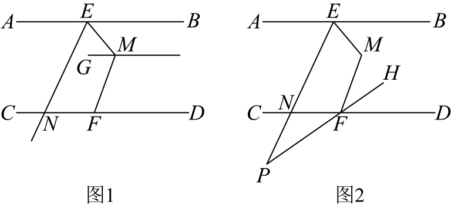

# Mathematics - 题目 3102

**ID**: 6d5941f7807a47eea186260917751303
**年级**: Grade 7
**难度**: Medium
**题型**: Calculation

## 题目
如图， $AB{\rm{/\mskip-4mu/}}CD$ ，点E，F分别为直线 $AB、CD$ 上的点，点M在两平行线 $AB$ 与 $CD$ 之间，连接 $EM$ ， $FM$ ， $\angle AEM$ 的平分线 $EN$ 交 $CD$ 于点N．（1）如图1，过点M作 $MG\mathrm{/\mskip-4mu/}AB$ ，若 $\angle AEN=65{}\degree $ ， $\angle EMF=120{}\degree $ ，求 $\angle MFD$ 的度数；​​​​​​​‌（2）如图 ${\rm 2，}\angle MFD$ 的平分线 $FH$ 的反向延长线交 $EN$ 于点P．① $\angle AEP=\angle EPH+\angle HFD$ 成立吗？请说明理由；②请直接写出 $\angle EMF$ 与 $\angle EPH$ 的数量关系．

## 解答

1. （1）解：∵ $EN$ 平分 $\angle AEM$ ， $\angle AEN=65{}\degree $ ，
2. ∴ $∠AEM=2∠AEN=130{}\degree $ ，
3. ∴ $∠BEM=180{}\degree -130{}\degree =50{}\degree $ ，
4. ∵ $MG\mathrm{/\mskip-4mu/}AB$ ，
5. ∴ $∠EMG=∠BEM=50{}\degree $ ，
6. ∵ $\angle EMF=120{}\degree $ ，
7. ∴ $∠GMF=120{}\degree -50{}\degree =70{}\degree $ ，
8. ∵ $MG\mathrm{/\mskip-4mu/}AB$ ， $AB{\rm{/\mskip-4mu/}}CD$ ，
9. ∴ $MG\mathrm{/\mskip-4mu/}CD$ ，
10. ∴ $\angle MFD=∠GMF=70{}\degree $ ；
11. （2）解：①成立；理由见详解：
12. 过点P作 $PQ\mathrm{/\mskip-4mu/}CD$ ，如图所示：
13. 
14. ∵ $AB/\mskip-4mu/CD$ ，
15. ∴ $AB\mathrm{/\mskip-4mu/}PQ\mathrm{/\mskip-4mu/}CD$ ，
16. ∴ $∠HFD=∠HPQ$ ， $\angle AEP=\angle EPQ$ ，
17. ∵ $∠EPQ=∠EPH+∠QPH=∠EPH+∠HFD$ ，
18. ∴ $\angle AEP=\angle EPH+\angle HFD$ ；
19. ②如图，过点M作 $MK/\mskip-4mu/AB$ ，
20. 
21. ∵ $AB/\mskip-4mu/CD$ ，
22. ∴ $CD\mathrm{/\mskip-4mu/}MK\mathrm{/\mskip-4mu/}AB$ ，
23. ∴ $\angle BEM=\angle EMK$ ， $\angle KMF=\angle MFD$ ，
24. ∴ $\angle EMF=\angle BEM+\angle MFD$ ，
25. ∵ $EN$ 平分 $\angle AEM$ ， $FH$ 平分 $\angle MFD$ ，
26. ∴ $\angle AEN=\angle MEN$ ， $\angle MFH=\angle HFD$ ，
27. 设 $\angle AEN=\angle MEN=y$ ， $\angle MFH=\angle HFD=∠PFN=x$ ，
28. ∴ $∠EMF=180{}\degree -2y+2x$ ，
29. 根据解析①可知： $∠EPH=∠AEN-∠HFD=y-x$ ，
30. ∴ $\angle EMF=180{}\degree -2y+2x=180{}\degree -2\left ({y-x}\right )=180{}\degree -2\angle EPH$ ，
31. 即 $∠EMF=180{}\degree -2∠EPH$ ．

## 知识点

**中文**:
  - 平行公理及推论
  - 角平分线
  - 平行线性质的应用

**English**:
  - Parallel Axiom
  - Angle Bisector
  - Applications of Properties

---
